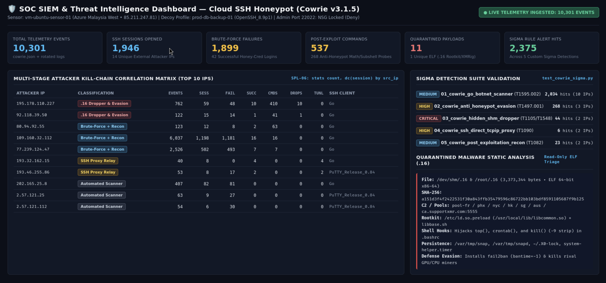
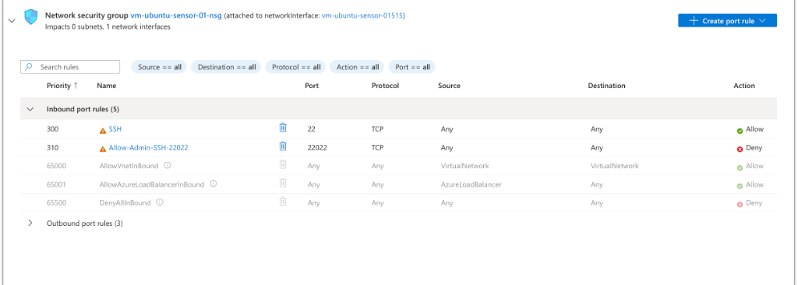
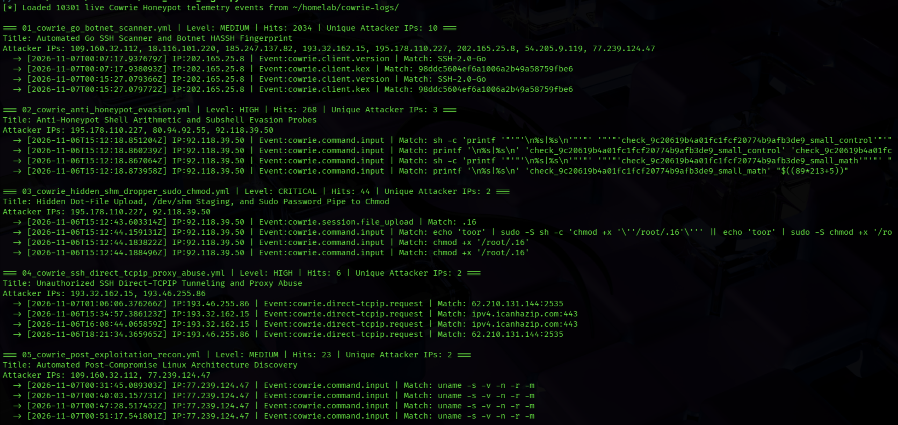

# Cloud SSH Honeypot (Cowrie) — Live Threat Intelligence, Sigma/SPL Detection Engineering & Rootkit Triage


## Executive Summary

Designed, hardened, and deployed an internet-facing **Cowrie v3.1.5 SSH/SFTP Honeypot** (`vm-ubuntu-sensor-01`, disguised as `prod-db-backup-01` running `OpenSSH_8.9p1`) in **Microsoft Azure (`Malaysia West`)** to capture real-world adversary tradecraft in the wild, engineer multi-field **Sigma** and **Splunk SPL** detections, and perform static binary analysis on captured Linux malware.

Over an initial collection window producing **10,301 live telemetry events** across **1,946 SSH sessions** from **14 unique external attacker IPs**:
1. **Engineered & Validated 5 Custom Sigma Rules + 6 Splunk SPL Queries:** Achieved **2,375 alert hits** across all five stages of the observed SSH attack lifecycle (HASSH botnet fingerprinting, anti-honeypot arithmetic/subshell evasion probes, `/dev/shm` hidden SFTP payload staging, `direct-tcpip` proxy tunneling, and post-exploitation architecture discovery).
2. **Captured & Reverse-Engineered a Live 3.37 MB Linux Rootkit/Cryptominer (`.16` / `Mexals`):** Intercepted 11 SFTP payload drops (`SHA-256: a151d3f4f2422531f30a843ffb35479596c86722bb103bdf8591105687f9b125`) and performed static ELF `.rodata` inspection, uncovering an embedded **XMRig Monero cryptominer** paired with an `/etc/ld.so.preload` userland rootkit (`libcommon.so`), `.bashrc` shell function hijackers (`top()`, `crontab()`, `kill()`), 4-layer persistence (`snap`/`snapd`/`.X0-lock`/`system-helper.timer`), and automated `fail2ban` installation.

---

## SOC SIEM & Threat Intelligence Dashboard



---

## Cloud Sensor Architecture & OPSEC Hardening

Full deployment and hardening documentation is available in [`deploy/hardening.md`](deploy/hardening.md) and [`deploy/cowrie.cfg.example`](deploy/cowrie.cfg.example).

- **Ubuntu 24.04 `ssh.socket` Migration (`Port 22022`):** Migrated real host OpenSSH off Port `22` to Port `22022` via `/etc/systemd/system/ssh.socket.d/override.conf` and enforced Ed25519 key-only authentication (`PasswordAuthentication no`, `PermitRootLogin no`).
- **Just-in-Time (JIT) Azure NSG Lockdown:** Configured Azure Network Security Group rule `310` (`Allow-Admin-SSH-22022`) to **`Action: Deny`** by default. Port `22022` is opened only briefly while pulling telemetry into an isolated **Kali Linux VM** over a **ProtonVPN** tunnel.
- **Unprivileged Container Isolation (`UID 999`):** Executed `cowrie/cowrie:latest` as non-root `999:999` with read-only configuration mounts (`:ro`) and automatic `0600` permission quarantine on all uploaded SFTP binaries.



---

## Live Telemetry & Multi-Stage Attacker Correlation (`10,301` Events)

Using our multi-stage Splunk SPL aggregation logic (`SPL-06` in [`detections/splunk_queries.spl`](detections/splunk_queries.spl)), raw JSON logs were correlated by `src_ip` across connection, authentication, command execution, SFTP upload, and TCP forwarding channels:

| Attacker IP | Classification | Total Events | Sessions | Failed Logins | Success Logins | Commands Run | SFTP Drops | Proxy Tunnels | Client Banner |
| :--- | :--- | ---: | ---: | ---: | ---: | ---: | ---: | ---: | :--- |
| `195.178.110.227` | **CRITICAL: `.16` Rootkit/XMRig Dropper** | 762 | 59 | 48 | 10 | 410 | **10** | 0 | `SSH-2.0-Go` |
| `92.118.39.50` | **CRITICAL: `.16` Rootkit/XMRig Dropper** | 122 | 15 | 14 | 1 | 41 | **1** | 0 | `SSH-2.0-Go` |
| `80.94.92.55` | **HIGH: Anti-Honeypot Evasion Node** | 123 | 12 | 8 | 2 | 63 | 0 | 0 | `SSH-2.0-Go` |
| `109.160.32.112` | **MEDIUM: High-Volume Brute Force + Recon** | 6,037 | 1,198 | 1,181 | 16 | 16 | 0 | 0 | `SSH-2.0-Go` |
| `77.239.124.47` | **MEDIUM: High-Volume Brute Force + Recon** | 2,526 | 502 | 493 | 7 | 7 | 0 | 0 | `SSH-2.0-Go` |
| `193.32.162.15` | **HIGH: SSH Direct-TCPIP Proxy Abuse** | 40 | 8 | 0 | 4 | 0 | 0 | **4** | `SSH-2.0-Go` |
| `193.46.255.86` | **HIGH: SSH Direct-TCPIP Proxy Abuse** | 53 | 8 | 17 | 2 | 0 | 0 | **2** | `PuTTY_Release_0.84` |
| `202.165.25.8` | **LOW: Automated SSH Scanner** | 407 | 82 | 81 | 0 | 0 | 0 | 0 | `SSH-2.0-Go` |
| `2.57.121.25` | **LOW: Automated SSH Scanner** | 63 | 9 | 27 | 0 | 0 | 0 | 0 | `PuTTY_Release_0.84` |
| `2.57.121.112` | **LOW: Automated SSH Scanner** | 54 | 6 | 30 | 0 | 0 | 0 | 0 | `PuTTY_Release_0.84` |

---

## Custom Sigma Detection Suite & Validation Results

All 5 Sigma rules in [`detections/sigma/`](detections/sigma/) were validated against the 10,301 live Cowrie events using [`detections/test_cowrie_sigma.py`](detections/test_cowrie_sigma.py):

| Rule File | Severity | MITRE ATT&CK | Live Hits | Unique IPs | Detection Logic Summary |
| :--- | :---: | :---: | ---: | ---: | :--- |
| [`01_cowrie_go_botnet_scanner.yml`](detections/sigma/01_cowrie_go_botnet_scanner.yml) | `MEDIUM` | `T1595.002`, `T1110.001` | **2,034** | 10 | Matches `SSH-2.0-Go` / `libssh` client banners and known botnet `HASSH` key-exchange hashes (`98ddc560...`). |
| [`02_cowrie_anti_honeypot_evasion.yml`](detections/sigma/02_cowrie_anti_honeypot_evasion.yml) | `HIGH` | `T1497.001`, `T1059.004` | **268** | 3 | Detects shell arithmetic expansion probes (`$((89*213+5))`), subshell variable scoping checks (`v=outer; (v=inner...)`), and `_small_math` / `_small_pid` verification tokens. |
| [`03_cowrie_hidden_shm_dropper_sudo_chmod.yml`](detections/sigma/03_cowrie_hidden_shm_dropper_sudo_chmod.yml) | `CRITICAL` | `T1105`, `T1564.001`, `T1548.003` | **44** | 2 | Detects hidden dot-file SFTP uploads (`.16`), `/dev/shm/` RAM-disk staging, and piping plaintext passwords into `sudo -S` to execute `chmod +x`. |
| [`04_cowrie_ssh_direct_tcpip_proxy_abuse.yml`](detections/sigma/04_cowrie_ssh_direct_tcpip_proxy_abuse.yml) | `HIGH` | `T1090`, `T1572` | **6** | 2 | Detects `cowrie.direct-tcpip.request` events where threat actors attempt to pivot traffic through the SSH server (`ipv4.icanhazip.com:443`, `62.210.131.144:2535`). |
| [`05_cowrie_post_exploitation_recon.yml`](detections/sigma/05_cowrie_post_exploitation_recon.yml) | `MEDIUM` | `T1082` | **23** | 2 | Detects automated post-login CPU/OS architecture profiling (`uname -s -v -n -r -m`, `/proc/cpuinfo`, `lscpu`). |



---

## Case Study Highlight: The `.16` (`Mexals / libbase`) Rootkit & Cryptominer

Full static analysis report: [`analysis/mexals-rootkit-case-study.md`](analysis/mexals-rootkit-case-study.md).

- **Anti-Honeypot Pre-Check (`T1497.001`):** Before uploading `.16`, nodes `92.118.39.50`, `195.178.110.227`, and `80.94.92.55` executed POSIX arithmetic (`$((89*213+5))`) and subshell scoping probes to verify they were interacting with a real Linux shell rather than a naive honeypot.
- **Hidden `/dev/shm` Execution (`T1564.001`, `T1548.003`):** Uploaded the `3,373,344`-byte 64-bit statically linked ELF executable (`SHA-256: a151d3f4f2422531f30a843ffb35479596c86722bb103bdf8591105687f9b125`) via SFTP to `/dev/shm/.16` and `/root/.16`, then piped the cracked password into `sudo -S sh -c 'chmod +x ...'`.
- **Userland Rootkit & Shell Function Hijacking (`T1574.006`, `T1546.004`):**
  - Injects `/usr/local/lib/libcommon.so` into `/etc/ld.so.preload` and hooks `.bashrc` via `/usr/local/libexec/libbase.sh`.
  - Overrides `top()` in the administrator's shell (`sed -e '/16/d' -e '/libbase\.sh/d'`) to hide the miner from process monitoring.
  - Overrides `crontab()` to hide `/var/tmp/snap`, `/var/tmp/snapd`, and `$HOME/.X0-lock` during `crontab -l` and automatically re-infects the crontab if the administrator runs `crontab -r`.
  - Overrides `kill()` to strip `-9`, `-KILL`, and `-SIGKILL` flags so the miner cannot be killed.
- **Competitor Elimination & `fail2ban` Deployment (`T1070.003`, `T1496`):** Kills rival GPU/CPU miners (`nvidia-smi ... xargs kill -9`, `pkill -9 -f '.b0s'`), mines Monero across 7 `supportxmr.com:5555` pools, and installs `fail2ban` (`bantime = -1`, `maxretry = 3`) to lock rival brute-force botnets out of SSH.

---

## Project Directory Structure

```text
homelab/cowrie-honeypot-soc/
├── README.md                                              # Project overview, telemetry matrix & detection results
├── analysis/
│   └── mexals-rootkit-case-study.md                       # Static ELF analysis of .16 (SHA-256: a151d3f4...)
├── deploy/
│   ├── cowrie.cfg.example                                 # Sanitized Cowrie deception configuration
│   └── hardening.md                                       # Ubuntu 24.04 ssh.socket, Azure NSG JIT & UID 999 guide
├── detections/
│   ├── sigma/
│   │   ├── 01_cowrie_go_botnet_scanner.yml                # HASSH & Go SSH scanner detection (2,034 hits)
│   │   ├── 02_cowrie_anti_honeypot_evasion.yml            # Shell arithmetic & subshell probe detection (268 hits)
│   │   ├── 03_cowrie_hidden_shm_dropper_sudo_chmod.yml    # /dev/shm .16 SFTP drop & sudo -S chmod (44 hits)
│   │   ├── 04_cowrie_ssh_direct_tcpip_proxy_abuse.yml     # SSH direct-tcpip relay abuse detection (6 hits)
│   │   └── 05_cowrie_post_exploitation_recon.yml          # Post-auth uname architecture discovery (23 hits)
│   ├── splunk_queries.spl                                 # 6 Splunk SPL detection & kill-chain correlation queries
│   └── test_cowrie_sigma.py                               # Multi-field Python Sigma validation script
└── screenshots/
    ├── 01_soc_siem_dashboard.png                          # SOC SIEM & Threat Intelligence Dashboard
    ├── 02_sigma_detection_hits.png                        # Kali terminal validation of all 5 Sigma rules
    └── 03_azure_nsg_jit_lockdown.png                      # Azure NSG Inbound Rules (Port 22022 Deny by Default)
```
