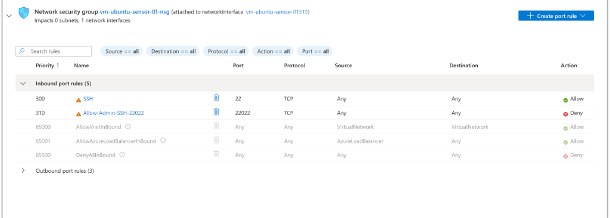

# Cloud Honeypot Architecture & OPSEC Hardening Guide

## 1. Defense-in-Depth Architecture Overview

Deploying an internet-facing SSH honeypot requires strict isolation between the **untrusted deception plane (Port `22/tcp`)**, the **cloud host control plane (Port `22022/tcp`)**, and the **analyst workstation (`Kali Linux VM`)**.

```
+-----------------------------------------------------------------------------------+
|                        INTERNET THREAT ACTORS & BOTNETS                           |
|     (Go SSH Scanners, Mexals .16 Rootkit/XMRig Loaders, SSH Proxy Relays)         |
+-----------------------------------------+-----------------------------------------+
                                          |
                                          | Port 22/TCP (Inbound: Allow Any)
                                          v
+-----------------------------------------------------------------------------------+
| AZURE CLOUD (Malaysia West) — Network Security Group (vm-ubuntu-sensor-01-nsg)    |
|  • Priority 300: Port 22/TCP    -> ALLOW (Routed to Cowrie Docker Container)      |
|  • Priority 310: Port 22022/TCP -> DENY BY DEFAULT (Just-in-Time Admin Toggle)    |
+-----------------------------------------+-----------------------------------------+
                                          |
        +---------------------------------+---------------------------------+
        |                                                                   |
        v (Port 22 -> Container Port 2222)                                  v (Port 22022 - JIT Only)
+-----------------------------------------------+   +-----------------------------------------------+
| DOCKER CONTAINER: cowrie/cowrie:latest        |   | HOST OS: Ubuntu 24.04 LTS (vm-ubuntu-sensor-01)|
|  • Runs as unprivileged UID/GID 999:999       |   |  • OpenSSH bound to Port 22022 via ssh.socket |
|  • Emulated FS (fs.pickle) — No Host Shell    |   |  • PubkeyAuthentication yes (Ed25519 Only)    |
|  • Decoy Hostname: prod-db-backup-01          |   |  • PasswordAuthentication no / RootLogin no   |
|  • Quarantined SFTP drops locked (chmod 0600) |   |  • Host auth logs sanitized for OPSEC         |
+-----------------------+-----------------------+   +-----------------------+-----------------------+
                        |                                                   ^
                        +---> Bind-Mounted JSON Logs (cowrie.json*) --------+
                                                                            |
                                           SCP Pull over Port 22022 via ProtonVPN Tunnel
                                                                            |
+---------------------------------------------------------------------------+-------+
| ISOLATED SOC ANALYST WORKSTATION (Kali Linux VM)                                  |
|  • Dedicated Ed25519 Admin Key (~/.ssh/honeypot_azure)                            |
|  • Offline Sigma Detection Engine (test_cowrie_sigma.py) & SPL SIEM Dashboard     |
+-----------------------------------------------------------------------------------+
```

---

## 2. Ubuntu 24.04 LTS OpenSSH Port Migration (`ssh.socket`)

Starting in Ubuntu 22.10+ and Ubuntu 24.04 LTS (`Noble Numbat`), OpenSSH uses **systemd socket activation (`ssh.socket`)** rather than reading `Port` directives directly from `/etc/ssh/sshd_config` at boot. Simply editing `/etc/ssh/sshd_config` leaves `systemd` listening on Port `22/tcp`, preventing Docker from binding Port `22`.

### Step 2.1: Override `ssh.socket` to Bind Port `22022`
```ini
# /etc/systemd/system/ssh.socket.d/override.conf
[Socket]
ListenStream=
ListenStream=0.0.0.0:22022
ListenStream=[::]:22022
```

> **Engineering Note:** The empty `ListenStream=` line is mandatory in `systemd` drop-in overrides; it clears the default `ListenStream=22` array before assigning `22022`.

### Step 2.2: Enforce Cryptographic Key-Only Authentication
```text
# /etc/ssh/sshd_config.d/99-admin-hardening.conf
Port 22022
PermitRootLogin no
PasswordAuthentication no
KbdInteractiveAuthentication no
PubkeyAuthentication yes
AllowUsers secadmin
```

Reload `systemd` and verify the socket migration prior to closing the active session:
```bash
sudo systemctl daemon-reload
sudo systemctl restart ssh.socket ssh.service
sudo ss -tlnp | grep 22022
```

---

## 3. Just-in-Time (JIT) Azure NSG Lockdown on Port `22022`

Even with Ed25519 key-only authentication, leaving an administrative SSH port exposed 24/7 on a honeypot IP allows adversaries to fingerprint the real host's OpenSSH banner and correlate it with the honeypot on Port `22`.



- **Default Posture (`Priority 310 — Allow-Admin-SSH-22022`):** Set to **`Action: Deny`** (`Source: Any`, `Port: 22022/TCP`). External port scans (`nmap -p-`) see **only Port `22/tcp` (Cowrie)** open on the entire VM.
- **Telemetry Retrieval Workflow:**
  1. Connect the **Kali Linux VM** to **ProtonVPN**.
  2. Temporarily toggle Rule `310` to `Allow` in the Azure Portal.
  3. Pull `cowrie.json*` via `scp -P 22022` into Kali.
  4. Immediately toggle Rule `310` back to **`Deny`**.

---

## 4. Non-Root Container Isolation (`UID 999`) & Payload Quarantine

Cowrie is deployed inside an isolated Docker container running as unprivileged user `cowrie` (`UID 999 / GID 999`):

```bash
sudo chown -R 999:999 ~/cowrie-data/var
sudo chmod -R 755 ~/cowrie-data/var

sudo docker run -d \
  --name cowrie \
  --restart unless-stopped \
  -p 22:2222/tcp \
  -v /home/secadmin/cowrie-data/etc:/cowrie/cowrie-git/etc:ro \
  -v /home/secadmin/cowrie-data/var:/cowrie/cowrie-git/var \
  cowrie/cowrie:latest
```

- **Read-Only Configuration Mount (`:ro`):** Prevents any container process from modifying `cowrie.cfg` or `userdb.txt`.
- **Automatic Payload Defanging:** Any file uploaded via SFTP (`cowrie.session.file_upload`) or downloaded via `wget`/`curl` is intercepted by Cowrie, hashed with SHA-256, and written to `var/lib/cowrie/downloads/<sha256>` with `0600` (`-rw-------`) permissions—**never executed on the host kernel**.
