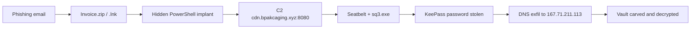

# Boogeyman 1 — Phishing to DNS Exfiltration Investigation

> TryHackMe SOC Level 1 capstone · Individual investigation · All data simulated

**Scenario:** A finance employee at *Quick Logistics LLC* received a fake invoice email. I investigated the email, endpoint PowerShell logs and a full packet capture to rebuild the attack and find out exactly what was stolen.

**Tools:** `awk`/`sed`/`base64`, `lnkparse`, `exiftool`, `jq`, Wireshark, `tshark`, Python, CyberChef, `keepassxc-cli`

## Key Findings
- **Initial access:** password-protected ZIP → `.lnk` disguised as Excel → hidden, fileless PowerShell.
- **Credential theft:** attacker dumped Sticky Notes (`plum.sqlite`) and recovered the KeePass master password from decimal-encoded C2 traffic.
- **Exfiltration:** KeePass vault hex-encoded and sent over DNS. I carved it back out of the PCAP (89 chunks, 2,206 bytes) and decrypted it to confirm the stolen corporate card.

## Files
| File | Purpose |
|---|---|
| [`report.md`](report.md) | **Start here:** full investigation report |
| [`timeline.md`](timeline.md) | Chronological attack timeline |
| [`iocs.md`](iocs.md) | Indicators of compromise |
| [`evidence.md`](evidence.md) | Raw evidence excerpts and commands |
| [`artifacts/`](artifacts/) | Extracted PowerShell 4104 script blocks |
| [`screenshots/`](screenshots/) | Annotated evidence screenshots (numbered in report order) |
